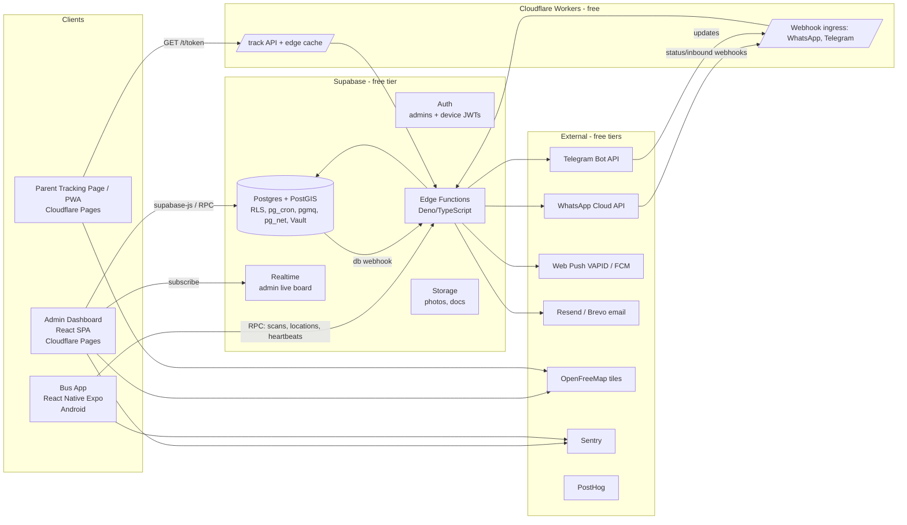
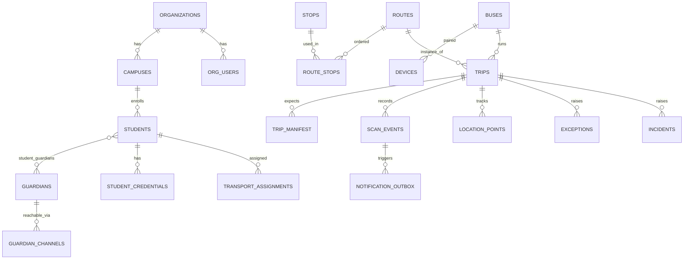

# UnWay — Product Requirements Document (PRD)

**Smart School Transportation Management Platform**

| Field | Value |
|---|---|
| Product | UnWay (Admin/School Dashboard, Android Bus App, Parent WhatsApp/Web experience, Platform backend) |
| Document version | 1.0 (MVP + roadmap) |
| Date | 3 October 2026 |
| Owner | Founder / Product (UnWay) |
| Status | Draft for build |
| Primary market | India (K-12 private schools and bus operators), English + Hindi + Telugu at launch |
| MVP constraint | **₹0 recurring software spend.** Every component has a free tier or open-source option, plus a documented paid upgrade path |

---

## Table of Contents

1. [Executive Summary](#1-executive-summary)
2. [Problem Statement](#2-problem-statement)
3. [Market & Competitor Research](#3-market--competitor-research)
4. [Where UnWay Wins (Differentiation)](#4-where-unway-wins-differentiation)
5. [Goals, Non-Goals & Success Metrics](#5-goals-non-goals--success-metrics)
6. [Users, Personas & Roles](#6-users-personas--roles)
7. [Core Concepts & Glossary](#7-core-concepts--glossary)
8. [End-to-End User Journeys](#8-end-to-end-user-journeys)
9. [Functional Requirements — Admin / School Dashboard](#9-functional-requirements--admin--school-dashboard)
10. [Functional Requirements — Android Bus App](#10-functional-requirements--android-bus-app)
11. [Functional Requirements — Parent Experience (WhatsApp-first)](#11-functional-requirements--parent-experience-whatsapp-first)
12. [Functional Requirements — UnWay Super-Admin Console & Operator Portal](#12-functional-requirements--unway-super-admin-console--operator-portal)
13. [Notification Engine](#13-notification-engine)
14. [Alerts, Exceptions & Incident Engine](#14-alerts-exceptions--incident-engine)
15. [Edge-Case Handling Matrix](#15-edge-case-handling-matrix)
16. [State Machines](#16-state-machines)
17. [QR Code Specification](#17-qr-code-specification)
18. [Location, Geofencing, Route & ETA Engine](#18-location-geofencing-route--eta-engine)
19. [Reports & Analytics](#19-reports--analytics)
20. [System Architecture](#20-system-architecture)
21. [Tech Stack — Free MVP Stack & Paid Upgrade Path](#21-tech-stack--free-mvp-stack--paid-upgrade-path)
22. [Data Model](#22-data-model)
23. [API Specification](#23-api-specification)
24. [External Services & Integrations](#24-external-services--integrations)
25. [Security, Privacy & Compliance (DPDP, CBSE)](#25-security-privacy--compliance-dpdp-cbse)
26. [Non-Functional Requirements](#26-non-functional-requirements)
27. [Free-Tier Capacity Budget](#27-free-tier-capacity-budget)
28. [Cost Model After the Free Tier](#28-cost-model-after-the-free-tier)
29. [Testing, QA & Pilot Plan](#29-testing-qa--pilot-plan)
30. [Delivery Roadmap & Milestones](#30-delivery-roadmap--milestones)
31. [Business Strategy: Pricing & Go-To-Market](#31-business-strategy-pricing--go-to-market)
32. [Risks & Mitigations](#32-risks--mitigations)
33. [Open Questions](#33-open-questions)
34. [Appendices](#34-appendices) (WhatsApp templates, repo structure, env vars, sources)

---

## 1. Executive Summary

UnWay is a school transportation **safety and accountability** platform. It connects schools, bus operators, buses, students and parents. It is built on three ideas:

1. **Verified custody of the child, not just bus location.** Most Indian products sell GPS dots on a map. UnWay records a verifiable chain of custody for every child: *boarded → reached school → boarded return bus → dropped off*. Each event is tied to a person, a time, a place and a bus. A scan is a signed QR that resolves to a student photo, so the conductor can confirm the face.
2. **Zero-install for parents, zero-hardware for schools.** Parents get updates on **WhatsApp**, which they already use. When WhatsApp isn't affordable yet, they get them on Telegram or web push. The bus needs only a **₹7–9k Android phone** running the UnWay Bus App. That phone is the GPS tracker, the QR scanner and the SOS button. Competitors usually need fixed GPS devices (₹3–5k each), RFID readers and cards, and a separate parent app.
3. **Bus-centric accounts.** Each bus has its own account and device pairing. Drivers and attendants rotate without any change to the system. Staff on the device see only what the trip needs.

The MVP runs entirely on free tiers: Supabase, Cloudflare Pages/Workers, Expo, OpenFreeMap/MapLibre, Telegram Bot API, Web Push and the WhatsApp Cloud API test number. The architecture is built so that each component can move to a paid tier without a rewrite.

---

## 2. Problem Statement

### 2.1 What schools and parents face today
- **Parent anxiety.** Industry write-ups describe school transport as "the single biggest source of parent anxiety in Indian schools." Parents call the school, the driver or the transport in-charge to ask "Has my child boarded?" and "Where is the bus?"
- **Manual registers.** Attendants tick paper lists, or don't. There is no reliable record of who boarded and who got off where.
- **No proof of drop-off.** When a child doesn't reach home, the school can't quickly answer *when, where and with whom* the child was last seen.
- **Child left on bus.** A sleeping child can be locked inside a parked bus. Few systems force an end-of-trip sweep.
- **Regulatory pressure.** CBSE transport guidelines require GPS, CCTV, speed governors (40 km/h), a trained attendant, emergency alarms and documented driver compliance. India is moving toward national RFID/IoT-based school bus tracking.
- **Expensive, hardware-heavy incumbents.** RFID attendance is often quoted at ₹5–15 lakh upfront for a school. Cards get forgotten, swapped or lost. Pricing is mostly "contact us."
- **Unreliable parent apps.** Global leaders such as Stopfinder and Here Comes the Bus get many reviews saying alerts "almost never work." One district had to switch an app off on the first day of school because it failed at scale.

### 2.2 The opportunity
Build a platform that is cheap to roll out, works offline and records custody. It should feel effortless to parents (WhatsApp) and give schools a defensible audit trail and analytics.

---

## 3. Market & Competitor Research

### 3.1 Indian competitors

| Competitor | What they offer | Model / hardware | Observed weaknesses / gaps |
|---|---|---|---|
| **NeoTrack** (neotrack.ai) | GPS tracking, boarding/drop notifications, RFID attendance, AI reports, multilingual; claims 650+ schools, 100k+ downloads | Parent app + RFID + GPS | Parents must install an app; RFID hardware cost; pricing not public |
| **My School Ride / SmartBus** (Uffizio, Satcop) | Live GPS, 180-day playback, RFID attendance, breach alerts (speed, deviation), 14+ reports, multi-branch, Manager/Driver/Parent apps | Certified GPS device install (1–2 days), RFID cards | Opaque pricing ("as per requirement"), hardware dependency, three separate apps |
| **TrackSchoolBus** | Five tiers: Basic Monitoring → Manual Attendance (attendant app) → RFID → UHF contactless → CCTV surveillance; 70+ reports, route planner/optimisation, fee payments, excursions | Device/RFID/UHF/CCTV tiers | Complex tiering, hardware-heavy, no public pricing |
| **SchoolDeck (Databus)** | Transport & bus management, AIS-140 + AIS-153 compliance | AIS-140 devices | Compliance/hardware focus, ERP-centric |
| **VersionX, Navionyx, Trackster, myskoolbus, eTechTracker, ProSchool360, EdPayU** | GPS tracking + alerts, some with attendant apps | Mostly GPS devices + parent apps | Commodity "dot on a map"; weak custody/exception workflows |
| **School ERPs** (MyClassBoard, Teachmint, Edunext, Entab, etc.) | Transport module inside an ERP | ERP add-on | Transport is a side feature with shallow exception handling; tied to that ERP |
| **Scholar Track** | WhatsApp attendance alerts for *classroom* attendance, zero hardware, free 1-class pilot | WhatsApp-only | Not transport-focused. **It validates WhatsApp-first, zero-hardware messaging in India** |

### 3.2 Global benchmarks (feature-depth reference)

| Product | Strengths to learn from | Weaknesses to avoid |
|---|---|---|
| **Edulog Student Ridership** | Detects missed stops, wrong-stop drop-off and **wrong-bus boarding**; ridership trends drive route consolidation; contact tracing; special-needs documentation | Enterprise and US-district oriented, heavy onboard tablets/MDTs |
| **Transfinder (Stopfinder parent app, Wayfinder driver nav, telematics)** | Driver turn-by-turn, parent app, integrated routing | Parent reviews: alerts/geofences unreliable, crashes, "works 5% of the time" |
| **Tyler Traversa / My Ride K-12** | Student ID card scanning, parent portal | Requires district SIS integration, ID cards |
| **Synovia "Here Comes the Bus"** | Large user base, simple ETA alerts | Failed at scale on a school's first day after rapid customer growth |
| **SafeStop, Zum** | Modern UX, real-time ETA, ops platform | US-centric, contracted fleets |

**Districts care most about** safety, a reliable parent experience (they read app store reviews), integration with student information systems, and leadership buy-in. (School Bus Fleet.)

### 3.3 Key market insights
1. **Hardware is the barrier.** Smartphones can stand in for GPS devices at zero hardware cost (EdPayU). Most Indian vendors still lead with devices.
2. **Parents won't install yet another app.** WhatsApp has near-universal reach in India, and Scholar Track shows the zero-onboarding model works.
3. **Reliability beats features.** The biggest global failures are notifications that don't arrive and systems that break on day one.
4. **Exception workflows are thin.** Most products notify on scans. Few handle the hard cases well: missed boarding, an unconfirmed drop-off, the wrong bus, a child left on the bus, a dead phone, or no network.
5. **Compliance is a tailwind.** CBSE requires GPS and attendants. DPDP Rules 2025 explicitly exempt *location tracking of a child during travel, for safety*, by transport providers serving educational institutions. Other data duties (consent, security, breach notice) still apply.

---

## 4. Where UnWay Wins (Differentiation)

| # | UnWay differentiator | Why it matters vs. competitors |
|---|---|---|
| D1 | **Phone-as-device:** one Android phone per bus does GPS, QR scanning, SOS and trip control | No ₹3–5k GPS device or RFID readers; onboarding a bus takes 10 minutes, not 1–2 days of installation |
| D2 | **WhatsApp-first, zero-install parents**, with free fallbacks (Telegram, Web Push, email) | Avoids parent-app fatigue and bad store reviews; the channel layer keeps costs controlled |
| D3 | **Signed QR plus photo verification** on every scan | Competitor RFID cards get swapped; UnWay shows the child's photo so the attendant confirms the face. Cards cost ~₹10 to print and can be reissued instantly |
| D4 | **Offline-first scanning**: the trip manifest is cached, scans are queued and synced | Works in network dead zones; no lost events |
| D5 | **Closed-loop custody**: every expected child ends each trip in a resolved state (scanned, absent, missed, handed over), and the trip can't close until all are resolved | Turns "tracking" into accountability with an auditable chain |
| D6 | **Mandatory "Empty Bus Check"** before a trip can complete | Directly prevents children being left on parked buses |
| D7 | **Bus-centric accounts with device pairing**; staff check in by name/PIN for an audit trail but need no account | Driver turnover never breaks the system |
| D8 | **Parent replies are actions**: "ABSENT", "STATUS", "LATE" over WhatsApp/Telegram | Fewer false missed-boarding alarms and fewer phone calls |
| D9 | **Self-learning routes and ETAs**: routes are recorded from the first runs, and ETAs come from our own historical stop-to-stop times | No paid routing APIs; ETAs improve with every trip |
| D10 | **Transparent pricing** published per student or bus | Every major Indian competitor hides pricing |
| D11 | **Multi-tenant for operators**: one operator can serve many schools | Operators are an under-served buyer segment |
| D12 | **DPDP-by-design**: minimal PII on devices, purpose-limited tracking, consent capture, retention policies, audit logs | Becomes a sales advantage as DPDP obligations phase in (most Rules operative by 14 May 2027) |
| D13 | **Reliability engineering as a feature**: notification delivery receipts, retries, fallbacks and a public status page | Targets the #1 complaint about competitors |

---

## 5. Goals, Non-Goals & Success Metrics

### 5.1 Product goals (MVP)
- G1. Admins can enroll students, issue QR cards and assign bus, route, stop and guardian in under 3 minutes per student, or in bulk via CSV.
- G2. Bus staff can run a full trip (start → scan → complete) with **≤2 taps per scan** and **≤1.5 s scan-to-confirmation**, including offline.
- G3. Parents get a boarding or drop-off notification within **60 s (p95)** of the scan when the device is online.
- G4. The admin live board shows every active bus, its students on board and its exceptions in real time (≤10 s staleness).
- G5. Every child on every trip has a final custody state, with a full journey history.
- G6. ₹0 software cost for a pilot of up to ~5 schools / ~50 buses (see §27).

### 5.2 Non-goals (MVP)
- Fee collection and payment gateways (Phase 3).
- Automatic route optimisation, the vehicle-routing problem (Phase 3; manual routes plus learned paths in the MVP).
- CCTV/live video streaming (out of scope; integrate with the vendor later).
- iOS bus app (Android only; the parent experience is channel-based, so it works on any phone).
- Fixed AIS-140 hardware integration (Phase 3 option for schools that already own devices).

### 5.3 Success metrics (pilot KPIs)

| Metric | Target |
|---|---|
| Scan compliance (riders scanned on both board and deboard) | ≥ 95% by week 3 of pilot |
| Notification delivery success (delivered/attempted) | ≥ 99% |
| p95 scan → parent notification latency | ≤ 60 s |
| Trips closed with all children resolved | 100% (system-enforced) |
| Parent opt-in rate to a notification channel | ≥ 80% |
| Reduction in parent calls to transport desk (school-reported) | ≥ 50% |
| Bus app crash-free sessions | ≥ 99.5% |
| Admin weekly active usage | ≥ 4 days/week per school |

---

## 6. Users, Personas & Roles

### 6.1 Personas
- **Priya, School Transport In-charge (primary admin).** Manages 15–60 buses. Lives on the phone during dispatch hours. Wants a single screen that shows what's wrong right now.
- **Principal / Management (viewer).** Wants weekly safety reports and incident accountability.
- **Ramesh, Driver** and **Lakshmi, Attendant/Conductor.** Mid-range Android literacy and local language. Need big buttons, few decisions, and no paperwork.
- **Parent / Guardian.** Uses WhatsApp daily. Wants "boarded", "reached", "dropped" plus an ETA when the bus is late. Won't install an app.
- **Bus Operator Owner (Phase 2).** Runs fleets for several schools. Cares about utilisation, driver behaviour and contracts.
- **UnWay Ops (internal).** Onboards schools, monitors health, manages templates and tenants.

### 6.2 Roles & permissions (RBAC)

| Capability | Super Admin (UnWay) | School Admin | Transport Manager | Viewer (Principal) | Operator Admin | Bus Device | Parent |
|---|---|---|---|---|---|---|---|
| Manage tenants/orgs | ✅ | — | — | — | — | — | — |
| School settings, users, roles | ✅ | ✅ | — | — | — | — | — |
| Students CRUD, QR issue | ✅ | ✅ | ✅ | 👁 | — | — | — |
| Guardians & contacts | ✅ | ✅ | ✅ | 👁 (masked) | — | — | own |
| Buses, devices, pairing | ✅ | ✅ | ✅ | 👁 | ✅ (own fleet) | — | — |
| Routes, stops, assignments | ✅ | ✅ | ✅ | 👁 | 👁/✅ (if delegated) | — | — |
| Live board & incidents | ✅ | ✅ | ✅ | 👁 | ✅ (own buses) | — | — |
| Resolve exceptions | ✅ | ✅ | ✅ | — | ✅ (own) | partial (trip) | — |
| Reports & exports | ✅ | ✅ | ✅ | ✅ | ✅ (own) | — | — |
| Start/end trips, scan | — | — | (override) | — | — | ✅ | — |
| View trip manifest | — | ✅ | ✅ | 👁 | ✅ | ✅ (minimal fields) | — |
| Child's journey & live map | — | ✅ | ✅ | ✅ | — | — | ✅ (own child, via signed link) |
| Mark absent / request help | — | ✅ | ✅ | — | — | — | ✅ |

👁 = read-only. "Minimal fields" for the device = first name + last initial, photo thumbnail, class/section, stop name, special-care flag. **No phone numbers, addresses or parent names.**

---

## 7. Core Concepts & Glossary

| Term | Definition |
|---|---|
| **Organization** | Tenant. Type `school` or `operator`. A school may have many **campuses**. |
| **Academic Session** | e.g. 2026–27. Enrollments and assignments are session-scoped. |
| **Student** | A child enrolled in transport. Has a permanent `public_id` (e.g. `UW-7F3K9Q`) and a QR credential. |
| **Guardian** | Parent/guardian with phone and channel preferences; many-to-many with students (siblings, two parents). |
| **Authorized Pickup Person** | An optional extra adult allowed to receive the child at the stop. |
| **Bus** | Vehicle with registration number, capacity, operator and compliance documents. One **Bus Account**. |
| **Device** | An Android phone paired to a bus account. One active device per bus (a backup device may be pre-paired but inactive). |
| **Crew** | Driver/attendant records (name, licence, PIN). Not login accounts. They check in on the device per trip. |
| **Route** | Ordered list of **Stops** with planned times, for a direction: `MORNING` (home → school) or `AFTERNOON` (school → home), plus optional variants (Saturday, half-day). |
| **Stop** | Geo point with geofence radius (default 75 m), name and landmark. |
| **Assignment** | Student ↔ (Route, Pickup Stop, Drop Stop, Bus) per direction, with an effective date range. |
| **Trip** | One run of a route by a bus on a date (`trip_date`, `direction`). States: scheduled → active → completing → completed/aborted. |
| **Manifest** | Expected riders for a trip, snapshotted at trip start (excluding pre-marked absences). |
| **Scan Event** | Immutable record: student, trip, bus, device, crew, type (`BOARD`/`DEBOARD`), timestamp (device + server), GPS, verification result. |
| **Custody State** | Per student per trip: `EXPECTED`, `ABSENT_NOTIFIED`, `ON_BOARD`, `DROPPED`, `MISSED`, `NO_SHOW`, `HANDED_OVER`, `UNCONFIRMED`, `TRANSFERRED`. |
| **Exception** | A system-detected anomaly that needs resolution (missed boarding, wrong bus, unconfirmed drop-off, etc.). |
| **Incident** | A safety event (SOS, breakdown, accident, overspeed, route deviation, child left on bus). |
| **Journey** | A student's day: morning trip + school arrival + afternoon trip + drop-off, shown as a timeline. |

---

## 8. End-to-End User Journeys

### 8.1 Onboarding a school (UnWay Ops + School Admin)
1. UnWay Ops creates the organization, campus, admin user and plan. The admin gets an email magic link.
2. The admin sets the school geofence (pin on map plus radius), session, timings, notification preferences and languages.
3. The admin adds buses (manually or by CSV) and pairs each bus phone: Dashboard → Bus → "Pair device" shows a one-time QR code. The bus app scans it and the device is bound.
4. The admin creates routes and stops by dropping pins on a map or importing CSV. Optionally the first run is driven in **Route Recording mode** to capture the real path.
5. The admin imports students and guardians by CSV (template provided) or adds them one by one, then assigns route, stop and bus.
6. The system generates QR ID cards as a printable PDF (A4, 10 per sheet, or CR80 card size).
7. Guardian opt-in: each guardian gets a welcome message (WhatsApp/Telegram/SMS-free link) with consent text. Consent is recorded.

### 8.2 Morning trip (home → school)
1. The attendant opens the bus app. It already shows the bus number. They pick crew from a list and enter a 4-digit PIN.
2. They tap **Start Morning Trip**. The app downloads or refreshes the manifest (expected students, photos, stops, absences) and starts GPS streaming.
3. At each stop the app highlights the current stop (by geofence) and lists the children expected there.
4. A child shows their QR. The scan shows a ✅ green screen with photo and name and a short vibration. A `BOARD` event is created and the parent is notified: *"Aarav boarded Bus AP09-1234 at Sai Nagar stop, 7:42 AM. Track: link."*
5. When the bus leaves a stop geofence with expected children unscanned, the app asks: *"2 children not boarded at Sai Nagar. Mark: Not present / Boarded (forgot to scan) / Wait."* Unresolved children become `MISSED` and an alert goes to the parent and admin.
6. At the school geofence the app prompts **"Arrived at school — scan deboarding"**, or "Mark all on board as dropped at school" if the school allows a bulk deboard. Each child gets `DROPPED`, and the parent gets *"Aarav reached school at 8:21 AM."*
7. **Empty Bus Check**: the attendant walks the bus and confirms "No child on bus" (with an optional photo). The trip is completed.

### 8.3 Afternoon trip (school → home)
1. **Start Afternoon Trip** loads the manifest minus any children marked absent today or picked up early by a parent (from the dashboard).
2. Boarding scans happen at the school. Before departure, the app shows *"36/38 boarded — 2 missing: [names]."* Departing requires a reason (e.g. "picked up by parent", "not found, admin informed"), which raises an admin alert.
3. At each drop stop the child deboard scan creates `DROPPED` and the parent gets *"Aarav was dropped at Sai Nagar stop at 3:52 PM."* The parent also gets an approaching-stop alert (configurable, free channels by default).
4. **Guardian-not-present policy** (configurable per student, e.g. age < 8): the attendant chooses **Handed over to guardian** (and selects the authorized person) or **Guardian absent → keep on bus**, which notifies the parent and admin and brings the child back to school/the next safe point.
5. At the end, any child boarded but not deboarded must be resolved before **Empty Bus Check** and trip completion.

### 8.4 Parent's day (WhatsApp)
- 6:30 PM the previous day (optional): "Reply ABSENT to tell us Aarav won't take the bus tomorrow."
- Morning: Boarded → Reached school. Afternoon: Boarded return bus → Approaching (optional) → Dropped.
- Anytime: the parent sends **STATUS** and gets the current state plus a live link. **HELP** connects to the transport desk number.
- Trip delayed by more than 10 minutes against the learned schedule: *"Bus AP09-1234 is running ~15 min late today. Live: link."*

### 8.5 Exception journey: wrong bus
1. A child scans on Bus 7 but is assigned to Bus 3. The app shows a 🟧 **"Wrong bus — Aarav belongs to Bus 3 (Route R3)"** with options **Deny boarding** / **Allow (temporary transfer)**.
2. Allow creates a `TRANSFERRED` custody record plus an admin alert. The parent is notified of the bus change. Deny records a `WRONG_BUS_ATTEMPT` event.

### 8.6 Emergency (SOS)
1. Press and hold SOS for 3 seconds and choose a type: Accident / Breakdown / Medical / Security / Other. Optionally add a voice note or photo.
2. The incident is created with live GPS and the on-board manifest. An alarm sounds on the admin dashboard, and an immediate WhatsApp/Telegram alert goes to the school emergency contacts.
3. The admin decides whether to send the parent broadcast (template "transport incident, children safe/being attended") so panic isn't automatic. An auto-escalation timer (e.g. 5 minutes unacknowledged) notifies the next contact in the escalation chain.

---

## 9. Functional Requirements — Admin / School Dashboard

**Platform:** responsive web app (desktop-first, usable on tablet/phone), React + TypeScript. Language: English UI in MVP; i18n-ready (Hindi/Telugu Phase 2).

Priority legend: **P0** = MVP must-have, **P1** = MVP if time / pilot, **P2** = post-MVP.

### 9.1 Global shell
| ID | Requirement | Priority |
|---|---|---|
| AD-SH-01 | Login via email + password or magic link; optional TOTP 2FA for School Admin | P0 / 2FA P1 |
| AD-SH-02 | Campus switcher (multi-campus orgs) and session switcher | P0 |
| AD-SH-03 | Global search (student name / public ID / guardian phone / bus number) | P0 |
| AD-SH-04 | Real-time alert tray (bell) with unresolved exceptions count + audible alarm for SOS | P0 |
| AD-SH-05 | Role-aware navigation; masked PII for viewer role | P0 |
| AD-SH-06 | Dark/light theme, keyboard shortcuts for live board | P2 |

### 9.2 Home / Live Operations Board (the "control room")
| ID | Requirement | Priority |
|---|---|---|
| AD-LB-01 | KPI strip: active trips, buses not started (vs scheduled), students on board now, students expected but not boarded, open exceptions, open incidents | P0 |
| AD-LB-02 | Live map (MapLibre) with all active buses, color by status (on-time / late / incident / offline >2 min), click → bus panel | P0 |
| AD-LB-03 | Bus panel: crew on duty, trip progress (stops done / total), on-board list, missing list, last GPS ping age, speed, battery of device | P0 |
| AD-LB-04 | Exceptions queue with one-click resolution actions (call guardian — reveals number to admin only, mark resolved with note, reassign) | P0 |
| AD-LB-05 | "Where is child X right now?" quick lookup — returns custody state + bus + last location | P0 |
| AD-LB-06 | Device health: offline buses, GPS disabled, low battery (<20%), app version outdated | P1 |
| AD-LB-07 | Late-start alert: trip not started X min after scheduled start | P0 |
| AD-LB-08 | Broadcast message to all parents of a bus/route (templated: delay, breakdown, holiday) | P1 |

### 9.3 Students module
| ID | Requirement | Priority |
|---|---|---|
| AD-ST-01 | List with filters: class/section, route, bus, stop, status (active/suspended/left), opt-in status, QR issued | P0 |
| AD-ST-02 | Create/edit profile: name, admission no., class/section, DOB (optional), gender (optional), photo (camera/upload, auto-crop & compress to ≤40 KB), blood group (optional), medical/special-care note (flag visible to crew as icon + short text), transport opt-in date | P0 |
| AD-ST-03 | Transport opt-in / opt-out with effective dates (history kept) | P0 |
| AD-ST-04 | Assignment editor: morning route + pickup stop, afternoon route + drop stop, bus (auto from route default), effective-from; supports different morning/afternoon buses | P0 |
| AD-ST-05 | Guardians: add 1–4 guardians, relation, phone (E.164), preferred language, channels (WhatsApp / Telegram / Web Push / Email), primary flag, consent status | P0 |
| AD-ST-06 | Authorized pickup persons (name, relation, phone, photo optional) | P1 |
| AD-ST-07 | QR credential: issue, print card, reissue (revokes previous version), view scan history | P0 |
| AD-ST-08 | Bulk import via CSV/XLSX with validation preview, error rows download, dedupe by admission no. | P0 |
| AD-ST-09 | Bulk actions: assign route/stop, print cards, send opt-in invite, suspend | P0 |
| AD-ST-10 | Student 360 page: profile, assignments, guardians, **journey timeline** (day view), attendance calendar (transport), exceptions history | P0 |
| AD-ST-11 | Temporary changes: one-day stop change / alternate drop address / "parent pickup today" | P1 |
| AD-ST-12 | Sibling linking (shared guardian; parents get combined messages where possible) | P1 |

### 9.4 Buses & Devices module
| ID | Requirement | Priority |
|---|---|---|
| AD-BU-01 | Bus CRUD: registration no., display name/number ("Bus 7"), capacity, operator, type, GPS-equipped (Y/N), CCTV (Y/N) | P0 |
| AD-BU-02 | Compliance docs with expiry reminders: fitness, permit, insurance, PUC, speed governor certificate (upload to storage) | P1 |
| AD-BU-03 | Device pairing: generate one-time pairing code (QR + 8-char code, 10 min TTL); list paired device (model, Android version, app version, last seen); unpair/rotate | P0 |
| AD-BU-04 | Bus status: active / maintenance / retired; substitute bus assignment for a date | P1 |
| AD-BU-05 | Crew directory: drivers & attendants (name, phone, licence no. & expiry, photo, medical check date, 4–6 digit PIN), assign default crew per bus | P0 |
| AD-BU-06 | Crew duty log: who checked in on which trip | P0 |

### 9.5 Routes & Stops module
| ID | Requirement | Priority |
|---|---|---|
| AD-RT-01 | Route CRUD: name/code, direction (MORNING/AFTERNOON), default bus, active days (Mon–Sat), scheduled start time, variants (half-day, Saturday) | P0 |
| AD-RT-02 | Map-based stop editor: click to add stop, drag to reorder, set geofence radius, planned time offset, landmark text | P0 |
| AD-RT-03 | Stop library shared across routes (one physical stop used by morning & afternoon) | P0 |
| AD-RT-04 | Route recording: import path recorded by bus app in "Record route" mode; smooth & simplify (Douglas-Peucker) → reference polyline | P1 |
| AD-RT-05 | Route capacity view: assigned students vs bus capacity, per stop counts | P0 |
| AD-RT-06 | Clone route (morning → afternoon reversed) | P0 |
| AD-RT-07 | Learned schedule: show planned vs median actual arrival per stop (last 20 trips) | P1 |
| AD-RT-08 | Route optimisation suggestions | P2 |

### 9.6 Trips module
| ID | Requirement | Priority |
|---|---|---|
| AD-TR-01 | Daily trip schedule auto-generated (pg_cron at 00:05 local) from active routes & calendar; manual add/cancel | P0 |
| AD-TR-02 | School calendar: holidays, half-days, exam days → affects trip generation & absence defaults | P0 |
| AD-TR-03 | Trip detail: timeline of stops (planned vs actual), scans list, map replay with breadcrumb, exceptions, incidents, crew, Empty Bus Check record | P0 |
| AD-TR-04 | Admin overrides: force-complete (with reason), mark scan manually (with reason — audited), transfer student between trips | P0 |
| AD-TR-05 | Trip replay (scrub GPS track with scan markers) | P1 |

### 9.7 Attendance & Journey history
| ID | Requirement | Priority |
|---|---|---|
| AD-AT-01 | Day grid: students × (AM board, school arrival, PM board, drop) with color states | P0 |
| AD-AT-02 | Student monthly transport attendance calendar | P0 |
| AD-AT-03 | Parent-declared absences list (from WhatsApp/Telegram "ABSENT") | P0 |
| AD-AT-04 | Export CSV/XLSX/PDF | P0 |

### 9.8 Exceptions & Incidents
| ID | Requirement | Priority |
|---|---|---|
| AD-EX-01 | Unified queue, filter by type/severity/bus/status; SLA timer; assign to user | P0 |
| AD-EX-02 | Resolution workflow with mandatory note; parent auto-update on certain resolutions (e.g. "found, safe") | P0 |
| AD-EX-03 | Incident report form (SOS follow-up): description, actions, attachments, closure; printable incident report | P1 |
| AD-EX-04 | Escalation chains per school (contact order, timeout) | P1 |

### 9.9 Communications
| ID | Requirement | Priority |
|---|---|---|
| AD-CM-01 | Notification settings per school: which events notify, channels allowed, quiet hours, approaching-stop alert on/off, language default | P0 |
| AD-CM-02 | Message log: every outbound message, channel, template, status (queued/sent/delivered/read/failed), cost estimate | P0 |
| AD-CM-03 | Guardian opt-in dashboard: % opted-in per channel, resend invites | P0 |
| AD-CM-04 | Inbound messages inbox (parent replies not handled by bot) | P1 |

### 9.10 Reports & Analytics — see §19.

### 9.11 Settings & Admin
| ID | Requirement | Priority |
|---|---|---|
| AD-SE-01 | School profile, logo (used on QR cards & tracking page), timezone, school geofence | P0 |
| AD-SE-02 | Users & roles management, invite by email | P0 |
| AD-SE-03 | Policy settings: allow bulk deboard at school, guardian-required-at-drop age threshold, duplicate-scan window (default 120 s), missed-boarding grace (default 0 stops), late threshold (default 10 min), overspeed threshold (default 40 km/h per CBSE) | P0 |
| AD-SE-04 | Data retention settings (GPS raw: 30–180 days; events: session + 1 yr) | P1 |
| AD-SE-05 | Audit log viewer (who changed what) | P1 |
| AD-SE-06 | API keys / webhooks for ERP integration | P2 |

---

## 10. Functional Requirements — Android Bus App

**Platform:** React Native (Expo SDK, dev-client build), Android 8.0+ (API 26+), optimized for low-end devices (2–3 GB RAM). Distribution: signed APK (MVP, sideload/MDM) → Google Play closed testing → production.

**Design principles:** large touch targets (≥56 dp), high-contrast, bilingual labels (English + local language), audible + haptic feedback, max 2 taps per routine action, works fully offline once a trip has started.

### 10.1 Device setup & auth
| ID | Requirement | Priority |
|---|---|---|
| BA-AU-01 | First launch → "Pair this phone": scan pairing QR from dashboard (or type code). Device receives long-lived **device refresh token** + bus binding; stored in Android Keystore (expo-secure-store) | P0 |
| BA-AU-02 | Home shows bus number large ("BUS 7 · AP09 AB 1234"), school name/logo; no username/password for staff | P0 |
| BA-AU-03 | Crew check-in per trip: select driver & attendant from bus crew list + PIN (offline-verifiable via salted hash cached on device) | P0 |
| BA-AU-04 | Admin can remotely unpair/lock device; app wipes cached data | P0 |
| BA-AU-05 | Optional kiosk mode (Android screen pinning / lock-task via device owner) for dedicated bus phones | P1 |

### 10.2 Home screen
- Today's trips for this bus (Morning R3 · 07:15, Afternoon R3-PM · 14:45) with state.
- Buttons: **Start Morning Trip**, **Start Afternoon Trip** (enabled ±60 min of schedule; outside window requires reason), **Record Route** (if enabled by admin), **SOS** (always visible), **Sync status** indicator (green/amber/red with pending event count), device checks (GPS on, location permission "Allow all the time", battery optimization disabled, camera permission).

### 10.3 Trip screen
| ID | Requirement | Priority |
|---|---|---|
| BA-TR-01 | Header: trip type, counters **Expected / Boarded / Remaining / Dropped**, elapsed time, network status | P0 |
| BA-TR-02 | Current/next stop card (auto from geofence), list of students for that stop with photo thumbnails and status chips | P0 |
| BA-TR-03 | Big **SCAN** button opens camera viewfinder (continuous scanning mode — stays open for consecutive kids) | P0 |
| BA-TR-04 | Scan result overlay ≤1.5 s: GREEN (valid, correct bus) with photo + name + "BOARDED"/"DROPPED"; ORANGE (wrong bus / wrong stop / already boarded) with actions; RED (invalid/revoked/unknown QR). Distinct sounds + vibration patterns. Auto-dismiss 1.5 s for green | P0 |
| BA-TR-05 | Board vs deboard auto-inferred from custody state (not on board → BOARD, on board → DEBOARD); manual toggle available | P0 |
| BA-TR-06 | Manual mark (no QR — card forgotten): search name in manifest → confirm with photo → reason "card forgotten" (audited, admin sees count) | P0 |
| BA-TR-07 | Stop departure check: on leaving geofence with unresolved expected students → modal to resolve (Not present / Boarded-forgot-scan / Wait) | P0 |
| BA-TR-08 | Missing list tab: everyone expected not yet boarded; on-board tab; dropped tab | P0 |
| BA-TR-09 | Arrive-school flow (morning): bulk "Deboard all at school" (if policy allows) or scan each | P0 |
| BA-TR-10 | Depart-school check (afternoon): block with warning if missing > 0; require reason | P0 |
| BA-TR-11 | Drop with guardian policy: for flagged students, prompt "Handed to guardian?" → select authorized person / guardian absent → keep on bus | P1 |
| BA-TR-12 | **Empty Bus Check** before completion: checklist ("Walked to last row", "Checked under seats"), optional photo, confirm by PIN | P0 |
| BA-TR-13 | Complete trip: blocked until every manifest entry has a final state; summary screen | P0 |
| BA-TR-14 | Mini map (optional, off by default to save data/battery) showing route & next stop | P2 |
| BA-TR-15 | Delay report quick action: "Traffic / Breakdown / Weather / Other" → admin + optional parent broadcast | P1 |

### 10.4 Background services
| ID | Requirement | Priority |
|---|---|---|
| BA-BG-01 | GPS tracking during active trip via Android **foreground service** with persistent notification ("UnWay trip active"); interval 5 s / 25 m displacement; upload batches every 10–15 s | P0 |
| BA-BG-02 | Offline queue (SQLite): scans, locations, exceptions, SOS; FIFO sync with idempotency keys; exponential backoff; survives app kill/reboot | P0 |
| BA-BG-03 | SOS sends via data; if no data within 20 s, fall back to **SMS intent** pre-filled to school emergency number (user taps send — SMS sending is free for the device's plan, not for UnWay) | P0 |
| BA-BG-04 | Heartbeat every 60 s (battery %, GPS accuracy, app version, pending queue size) | P0 |
| BA-BG-05 | Auto-end protection: trip active > 4 h → reminder to complete; stationary at depot > 20 min → prompt | P1 |
| BA-BG-06 | Speed monitoring from GPS; overspeed events (> threshold for > 15 s) logged | P1 |
| BA-BG-07 | Harsh braking/acceleration via accelerometer | P2 |

### 10.5 Data minimization on device
- Manifest contains only: student internal UUID, display name (first + last initial), class/section, photo thumbnail (≤20 KB WebP), stop ID, special-care icon + ≤60-char note, custody state.
- Cache wiped 2 h after trip completion; photos cached encrypted.
- No guardian data, no addresses, no phone numbers on device. "Call school" button dials the school transport desk number only.

### 10.6 Bus app screens list
1. Pairing  2. Home (bus + trips)  3. Crew check-in  4. Pre-trip checks  5. Trip (stop view)  6. Scanner (continuous)  7. Scan result overlay  8. Missing / On-board / Dropped tabs  9. Manual mark search  10. Stop departure resolution modal  11. Arrive school / Depart school checks  12. Empty Bus Check  13. Trip summary  14. SOS (type picker, sending state, acknowledged state)  15. Sync status/diagnostics  16. Route recording  17. Settings (language, sound, about, unpair locked by admin PIN)

---

## 11. Functional Requirements — Parent Experience (WhatsApp-first)

Parents **do not install an app**. Channels (in order of preference, configurable per school & guardian):

| Channel | Cost | Use |
|---|---|---|
| **WhatsApp Business Cloud API** (direct from Meta, no BSP markup) | Paid per delivered template (India utility ≈ ₹0.115/msg as of Oct 2026); test number free for 5 recipients | Primary channel once school is on paid plan |
| **Telegram Bot** | Free (≈30 msg/s global, 1 msg/s per chat) | Free fallback & MVP primary for opted-in parents |
| **Web Push** (installable PWA "UnWay Parent", VAPID, no app store) | Free | Free fallback; Android Chrome works well, iOS 16.4+ only if added to home screen |
| **Email** (Resend/Brevo free tier) | Free up to daily caps | Daily/weekly summaries, onboarding, receipts — not real-time critical |
| SMS | Paid (DLT registration needed in India) | Not in MVP; Phase 2 for critical alerts (SOS, missed boarding) only |

### 11.1 Parent features
| ID | Requirement | Priority |
|---|---|---|
| PA-01 | Opt-in & consent: welcome message with consent text + "Reply YES" (WhatsApp/Telegram); consent stored with timestamp, channel, text version | P0 |
| PA-02 | Event notifications: Boarded (AM), Reached School, Boarded (PM), Dropped; plus Missed Boarding, Not Boarded at School, Unconfirmed Drop, Bus Transfer, Delay, Incident (admin-approved) | P0 |
| PA-03 | Secure tracking link in messages → mobile web page: live bus position, ETA to child's stop, child's status timeline for today, school contact button. Link token scoped to (student, date), expires end of day | P0 |
| PA-04 | Keyword commands: `STATUS`, `ABSENT` (tomorrow by default; `ABSENT TODAY`, `ABSENT AM/PM`), `PICKUP` (parent will collect from school today — removes from PM manifest pending admin approval), `HELP`, `STOP` (unsubscribe), `LANG HI/TE/EN` | P0 (STATUS/ABSENT/HELP/STOP), P1 rest |
| PA-05 | Approaching-stop alert ("~5 min away") — default ON for free channels, OFF for WhatsApp (cost) unless school opts in | P1 |
| PA-06 | Multi-child: one message lists siblings when events coincide (same bus, within 60 s) | P1 |
| PA-07 | Language per guardian: English, Hindi, Telugu at launch | P0 (EN), P1 (HI/TE) |
| PA-08 | Weekly summary (email/Telegram): rides taken, on-time %, any exceptions | P2 |
| PA-09 | Parent web portal (magic-link via channel): view journey history 30 days, manage channels, authorized pickup persons | P2 |

### 11.2 Tracking page (public route `/t/{token}`)
- Server validates token (HMAC/JWT, `sub=student_id`, `date`, `exp`), returns snapshot: bus number, trip state, last position (lat, lng, heading, ts), ETA to stop, child events today.
- Polls every 10 s through a **Cloudflare Worker with 5–10 s edge cache per trip** (protects Supabase egress quota). Shows "last updated Xs ago"; greys out if > 2 min stale.
- No child photo, no full name on the page (first name only), no other children's info.
- Map: MapLibre GL JS + OpenFreeMap tiles; bus marker + child's stop + school.

---

## 12. Functional Requirements — UnWay Super-Admin Console & Operator Portal

### 12.1 Super-Admin (internal, P0 minimal)
- Tenants: create org (school/operator), campuses, plan, limits, feature flags.
- Impersonate (read-only, audited) for support.
- Template manager: WhatsApp templates (name, language, category, status synced from Meta), Telegram/web/email copies.
- System health: queue depth, notification success rate per channel, device fleet versions, error rate (Sentry link), DB size vs free quota, egress usage.
- Kill-switches: pause WhatsApp sends globally/per tenant (cost control), force app update minimum version.

### 12.2 Operator Portal (Phase 2)
- Operator sees own fleet across multiple schools, bus utilisation, crew, compliance doc expiries, safety events, contract reports per school.
- Schools grant operator access to specific routes; operator cannot see guardian PII.

---

## 13. Notification Engine

### 13.1 Pipeline
```
scan_events INSERT ─► DB trigger (custody update) ─► notification_outbox rows (one per guardian×channel)
                                                         │
               Supabase Database Webhook (pg_net) ───────┤  immediate dispatch
               pg_cron sweeper every 30 s ───────────────┘  retries / missed webhooks
                                                         ▼
                                  Edge Function `dispatch-notifications`
                         ┌───────────────┬──────────────┬─────────────┬──────────┐
                         ▼               ▼              ▼             ▼
                 WhatsApp Cloud API   Telegram Bot   Web Push      Email (Resend)
                         │
             status webhooks (sent/delivered/read/failed) ─► notification_outbox.status
```

### 13.2 Rules
- **Idempotency:** outbox unique key `(event_id, guardian_id, channel)`; provider message IDs stored.
- **Fallback:** if WhatsApp fails (error/undelivered after 5 min) and guardian has another channel → send there. Critical events (MISSED, SOS-approved, UNCONFIRMED_DROP) always go to **all** opted-in channels.
- **Coalescing:** if BOARD and DEBOARD within 3 min (scan error), send only the corrected state. Siblings coalesced (PA-06).
- **Quiet hours** don't apply to safety events.
- **Rate limits:** Telegram ≤25 msg/s global token bucket, 1/s per chat; WhatsApp tier awareness (new numbers start at 250 business-initiated unique recipients/24 h → 1k → 10k → 100k → unlimited; ramp quality before onboarding big schools).
- **Cost guard:** per-tenant monthly WhatsApp budget; when 90% consumed → non-critical events switch to free channels; admin notified.
- **Templates are pre-approved** (Meta utility category). Variables never include sensitive data beyond first name, time, bus number, stop name, link.

### 13.3 Event → message matrix (defaults)

| Event | Recipient | Default channels | Template (see Appendix A) |
|---|---|---|---|
| Opt-in / welcome | Guardian | WA/TG/Email | `unway_welcome_optin` |
| AM Boarded | Guardian | WA or TG/Push | `unway_boarded` |
| Reached school | Guardian | WA or TG/Push | `unway_reached_school` |
| PM Boarded | Guardian | WA or TG/Push | `unway_boarded_return` |
| Approaching stop | Guardian | TG/Push (WA opt-in) | `unway_approaching` |
| Dropped | Guardian | WA or TG/Push | `unway_dropped` |
| Missed boarding (AM stop) | Guardian + Admin | All | `unway_missed_boarding` |
| Not boarded at school (PM) | Guardian + Admin | All | `unway_not_boarded_return` |
| Unconfirmed drop | Admin (+Guardian after admin check 5 min) | All | `unway_drop_unconfirmed` |
| Bus transfer / wrong bus allowed | Guardian + Admin | WA or TG | `unway_bus_changed` |
| Delay > threshold | Guardians on trip | WA or TG | `unway_delay` |
| Incident broadcast (admin-approved) | Guardians on bus | All | `unway_incident_update` |
| SOS | School emergency contacts | All + dashboard alarm | `unway_sos_staff` |
| Absence confirmation | Guardian | Same channel as request (service reply) | free-form within 24 h window |

---

## 14. Alerts, Exceptions & Incident Engine

Rules evaluated in Postgres functions (on scan/location insert) and pg_cron jobs (every 1 min).

| Code | Detection logic | Severity | Auto actions |
|---|---|---|---|
| `TRIP_LATE_START` | Trip `scheduled` and now > start + 10 min | Medium | Admin alert |
| `DEVICE_OFFLINE` | Active trip, no heartbeat/location > 3 min | High | Admin alert; tracking page shows stale |
| `MISSED_BOARDING` | Bus exits pickup stop geofence; student EXPECTED, not absent, not resolved | High | Guardian + admin notify; state MISSED |
| `NOT_BOARDED_RETURN` | Afternoon trip departs school geofence; expected student not on board & not excused | Critical | Admin + guardian; requires resolution |
| `WRONG_BUS` | Scanned student not on this trip's manifest but assigned to another active trip today | Medium | Crew prompt; if allowed → TRANSFERRED + notify |
| `WRONG_STOP_DROP` | DEBOARD scan > 300 m from assigned drop stop and not school | Medium | Admin alert; guardian notified with actual location name |
| `DUPLICATE_SCAN` | Same student same type within window (120 s) | Info | Ignored, no notify |
| `UNCONFIRMED_DROP` | Trip completion attempted with ON_BOARD students | Critical | Blocks completion until resolved |
| `CHILD_LEFT_ON_BUS_RISK` | Empty Bus Check skipped/failed OR trip auto-closed by timeout | Critical | Escalation chain |
| `OVERSPEED` | Speed > threshold (default 40 km/h) for ≥15 s | Medium | Logged; admin digest; real-time if > threshold + 20 |
| `ROUTE_DEVIATION` | Bus > 300 m from reference polyline for > 2 min (PostGIS `ST_Distance` on geography) | Medium | Admin alert; P1 parent notice |
| `LONG_STOP` | Stationary > 10 min outside stop/school geofence during trip | Medium | Admin alert (possible breakdown) |
| `DELAY` | Predicted arrival at next stops > learned schedule + threshold | Low/Med | Parent delay message (once per trip) |
| `SOS` | Manual | Critical | Alarm, escalation, location share |
| `MANUAL_MARK_ABUSE` | Manual marks > 20% of scans on a trip | Low | Weekly report, crew coaching |

Exception lifecycle: `OPEN → ACKNOWLEDGED → RESOLVED` (or `AUTO_RESOLVED`), with assignee, notes, SLA timers (Critical: ack ≤ 2 min).

---

## 15. Edge-Case Handling Matrix

| Scenario | System behavior |
|---|---|
| Child forgot QR card | Manual mark from manifest with photo confirmation; reason logged; parent notified normally; admin report counts "manual marks" |
| QR card lost / stolen | Admin reissues → version increments → old QR returns RED "revoked"; attempt logged with GPS |
| Photocopy/screenshot of QR | Valid signature still passes, but **photo shown** for visual check; scans of same QR on two buses within 30 min → `CREDENTIAL_CLONE_SUSPECT` alert |
| Double scan | Ignored within window; shows "Already boarded 7:42" orange |
| Child scans board but never deboards (morning) | At school arrival, bulk deboard or prompt; else UNCONFIRMED at completion |
| Child scanned on wrong bus | §8.5 flow |
| Child boards at wrong stop (same bus) | Accept; record actual stop; info-level note to admin |
| Parent marked absent but child shows up | Scan works normally; absence auto-cancelled; parent gets boarded message |
| Parent picks child from school (PM) | Admin marks "Parent pickup" (or parent sends PICKUP → admin approves) → removed from PM manifest |
| Bus breakdown → students moved to another bus | Admin "Transfer trip riders" → creates TRANSFERRED records on rescue bus's trip; rescue bus app receives updated manifest via realtime; parents notified with new bus number |
| Substitute bus (planned) | Admin sets substitute for date; device of substitute bus gets the route's trip |
| Bus phone dead / forgotten | Backup: attendant logs into **web Bus Mode** on any phone browser with bus code + crew PIN + admin-issued one-day code (P1); worst case admin marks attendance from dashboard post-hoc (flagged) |
| No mobile data on route | Offline queue; scans still validated locally (signed QR + cached manifest); notifications sent on sync with real event time ("boarded at 7:42" even if sent 7:55) |
| GPS poor / indoor | Use last good fix; geofence events require accuracy ≤ 50 m, else rely on crew confirmation |
| Device time wrong | Server stores both `device_ts` and `server_ts`; device clock skew computed from heartbeat; corrected time used if skew > 60 s |
| Trip never started | `TRIP_LATE_START`; admin can start remotely? No — admin can call crew; if bus runs without app, admin can mark manual attendance later (flagged) |
| Trip not completed (crew forgot) | Reminder at +4 h; at end of day auto-close as `ABORTED_AUTO` + `CHILD_LEFT_ON_BUS_RISK` if on-board > 0 |
| Half-day / holiday | Calendar suppresses trip generation; ad-hoc trip creation |
| New student mid-session | Admin assigns; device manifest refresh on next trip start (or live push if trip active) |
| Two guardians, different languages | Each gets their own language |
| Guardian number changed | Admin edit → new opt-in invite; old number deactivated |
| Guardian replies STOP | Channel disabled; admin dashboard flags "no active channel" student |
| Shared custody / restraining order | Student flag "Restricted pickup list" → only listed persons for handover; crew sees "Handover restricted" icon (P1) |
| Child with special needs/medical | Icon + short note visible to crew; optional mandatory guardian handover |
| Excursion / field trip | P2: ad-hoc trip type with custom manifest |

---

## 16. State Machines

### 16.1 Trip
```
SCHEDULED ──start(crew, device)──► ACTIVE ──arrive_destination──► COMPLETING ──empty_bus_check_ok & all_resolved──► COMPLETED
    │                                 │                                 │
    │                                 └──sos──► ACTIVE (incident open)  └──admin_force(reason)──► COMPLETED_FORCED
    └──cancel(admin)──► CANCELLED      └──timeout(end of day)──► ABORTED_AUTO (raises CHILD_LEFT_ON_BUS_RISK if on-board>0)
```

### 16.2 Student custody (per trip)
```
EXPECTED ─parent ABSENT─► ABSENT_NOTIFIED (terminal unless scanned)
EXPECTED ─BOARD scan/manual─► ON_BOARD ─DEBOARD scan─► DROPPED
                                       ─handover─► HANDED_OVER
                                       ─transfer─► TRANSFERRED (new record ON_BOARD on other trip)
                                       ─trip end unresolved─► UNCONFIRMED ─admin resolve─► DROPPED/HANDED_OVER/...
EXPECTED ─bus leaves stop / leaves school─► MISSED ─late scan─► ON_BOARD
                                             ─crew "not present"─► NO_SHOW
```
Terminal states for completion: `DROPPED, HANDED_OVER, NO_SHOW, ABSENT_NOTIFIED, TRANSFERRED, MISSED(resolved)`.

### 16.3 Scan validation pipeline (on device, then re-validated on server)
1. Parse QR → format check (`UW1:` prefix).
2. Verify Ed25519 signature with tenant public key (cached) → else RED "Invalid card".
3. Check revocation list (cached `credential_version` per student) → else RED "Card replaced".
4. Lookup in manifest → if absent: check "other buses today" list (cached lightweight index of student_id→bus) → ORANGE wrong bus; else RED "Not registered for transport".
5. Duplicate window check → ORANGE "Already scanned".
6. Infer BOARD/DEBOARD → write event to SQLite with UUIDv7 `client_event_id` → GREEN.
7. Sync → server `record_scan` RPC re-validates and is idempotent on `client_event_id`.

---

## 17. QR Code Specification

- **Payload (v1):** `UW1:{tenant_short}:{student_public_id}:{cred_version}:{sig}`
  - `tenant_short`: 4-char org code; `student_public_id`: 8-char Crockford base32 (`7F3K9Q2M`); `cred_version`: integer; `sig`: base64url Ed25519 signature over `UW1:{tenant}:{id}:{ver}` (64 bytes → 86 chars).
  - Total ≈ 110 chars → QR version 6–7, error correction **Q** (25%) for scuffed cards.
- **No PII in QR** — a stranger scanning with a phone camera sees only an opaque string (optionally prefix with URL `https://unway.in/q/...` that shows "This is an UnWay transport card" with no data — P1).
- **Signing keys:** per-tenant Ed25519 keypair; private key in Supabase Vault (used only by `issue-credential` Edge Function); public key shipped to devices. Key rotation supported via `key_id` (future `UW2` format).
- **"Permanently linked"** = the `student_public_id` never changes; only `cred_version` increments on reissue.
- **Card print:** PDF generated client-side (pdf-lib) — CR80 (85.6×54 mm) or A4 sheet of 10; contains school logo, student first name + class, photo (optional), bus/route code, QR, "If found, call school: …". Lamination recommended; laminated card ≈ ₹10–20 at local print shops.
- **Alternatives later:** NFC stickers/cards (NTAG215 ~₹15–25) readable by most Android phones — P2 option with same signed payload.

---

## 18. Location, Geofencing, Route & ETA Engine

### 18.1 Location ingestion
- Device sends batches: `[{ts, lat, lng, acc, speed, heading, battery}]` every 10–15 s (interval 5 s / 25 m).
- Server stores **latest position** in `bus_live_state` (1 row per bus, UPSERT) → realtime/polling reads this cheap row.
- Raw points stored in `location_points` (partitioned monthly), **downsampled** after 7 days (keep 1 point / 30 s) and **purged** after retention (default 90 days) — keeps the 500 MB free DB healthy.

### 18.2 Geofencing (PostGIS)
- Stops/school: `geography(Point)` + `radius_m`. Server checks `ST_DWithin` on each batch's last point; device also evaluates locally for offline prompts.
- Enter/exit events recorded in `geofence_events` with hysteresis (enter at r, exit at r+25 m) to avoid flapping.

### 18.3 Route reference
- MVP: polyline from admin-drawn stop sequence (straight segments) **or** recorded path (Route Recording mode, P1).
- Optional free routing for drawing road-snapped polylines: **OpenRouteService** free key (directions quota ≈ 2,000/day) or a self-hosted **OSRM** with the India OSM extract (Geofabrik) on an Oracle Always Free VM. Only used at route-design time, never per trip.

### 18.4 ETA (no paid API)
1. **Learned segment times:** for each consecutive stop pair (and time-of-day bucket, weekday), store median & p80 duration from the last 20 completed trips (`segment_stats` materialized nightly).
2. Live ETA to stop k = remaining time on current segment (progress = distance along polyline) + Σ median segment times to k + dwell time medians.
3. Cold start (no history): distance along polyline ÷ 20 km/h city average + 45 s per stop dwell.
4. Delay = live ETA − planned time; triggers `DELAY` if > threshold.

### 18.5 Map rendering
- **MapLibre GL JS** (web) + **OpenFreeMap** vector tiles (free, no API key, no limits, commercial use allowed; self-hostable later).
- Bus app: map optional; if needed `@maplibre/maplibre-react-native` with the same tiles.
- Geocoding for address search in stop editor: **Nominatim** public (≤1 req/s, attribution, no bulk) or **Photon**; admins primarily drop pins.

---

## 19. Reports & Analytics

All reports filterable by date range, campus, route, bus; export CSV/XLSX/PDF (client-side generation with SheetJS / pdf-lib — free).

| # | Report | Content | Priority |
|---|---|---|---|
| R1 | Daily transport attendance | Per student AM/PM board/drop with times & stops | P0 |
| R2 | Student journey history | Full timeline per student, any date range | P0 |
| R3 | Exceptions summary | Counts by type, bus, route; resolution times; open items | P0 |
| R4 | Trip performance / on-time | Planned vs actual start/stop arrivals, on-time % (≤5 min), avg delay per route | P0 |
| R5 | Scan compliance | % riders scanned both legs, manual-mark %, by bus/crew | P0 |
| R6 | Bus utilisation | Avg riders vs capacity per trip; under/over-utilised routes | P1 |
| R7 | Safety events | Overspeed, route deviations, long stops, SOS, Empty-Bus-Check compliance; per bus/crew | P1 |
| R8 | Notification delivery | Sent/delivered/read/failed per channel; cost | P0 |
| R9 | Recurring issues | Students frequently missing, stops with frequent delays, buses with frequent offline | P1 |
| R10 | Compliance register | Bus docs expiry, crew licence/medical expiry (CBSE) | P1 |
| R11 | Management weekly digest (email PDF) | KPIs, top issues, trends | P2 |

Analytics implementation: SQL views + nightly materialized views (pg_cron) — no separate warehouse in MVP. Product analytics (usage of dashboard features) via **PostHog** free tier (1M events/month) — never send child PII.

---

## 20. System Architecture

### 20.1 High-level diagram


### 20.2 Architectural decisions (ADRs)
| ADR | Decision | Rationale |
|---|---|---|
| ADR-1 | **Supabase (Postgres) as system of record** | Relational data (students↔guardians↔routes↔trips) fits SQL; PostGIS for geofencing; RLS for multi-tenant security; Auth + Realtime + Storage + Functions in one free project; zero lock-in (plain Postgres, can self-host) |
| ADR-2 | **Business logic in Postgres functions (RPC)** for scans & custody transitions | Atomic, transactional, idempotent; fewer network hops; free (no compute billing on functions) |
| ADR-3 | **Edge Functions for integrations** (WhatsApp/Telegram/push, QR signing, device auth) | Secrets isolation; 500k invocations/month free |
| ADR-4 | **Cloudflare in front of public parent traffic** | Edge-cache tracking snapshots → protects Supabase 5 GB egress; free unlimited static hosting with commercial use permitted |
| ADR-5 | **Outbox pattern** for notifications | Reliability, retries, auditing, no lost messages |
| ADR-6 | **Offline-first bus app with local SQLite + signed QR** | Network dead zones are common on Indian routes |
| ADR-7 | **TypeScript everywhere** + shared `zod` schemas in monorepo | One language for a small team; shared types between app/web/functions |
| ADR-8 | **Channel abstraction** (`NotificationChannel` interface) | Swap WhatsApp ↔ Telegram ↔ SMS by config, control cost |
| ADR-9 | **No unofficial WhatsApp libraries** (whatsapp-web.js, Baileys) in production | Violates WhatsApp ToS; number bans would cut off every parent at once — unacceptable for a safety product. Acceptable only for a throwaway internal demo |
| ADR-10 | **Admin realtime via Supabase Realtime; parents via polling** | Keeps concurrent realtime connections (free-tier capped) for the few admins; thousands of parents hit cached HTTP |

### 20.3 Device authentication flow
1. Admin clicks Pair → Edge Function `create-pairing-code` stores hashed code (TTL 10 min).
2. App POSTs `/v1/devices/pair {code, device_info}` → function validates, creates `devices` row, issues **device refresh token** (random 256-bit, hashed in DB) and a short-lived **JWT** (signed with Supabase JWT secret, claims: `role=bus_device`, `bus_id`, `org_id`, `device_id`, `exp=1h`).
3. App refreshes JWT via `/v1/devices/token`. RLS policies use `auth.jwt()->>'bus_id'` to restrict data to that bus's trips/manifests.
4. Unpair = revoke refresh token; next refresh fails → app wipes data.

---

## 21. Tech Stack — Free MVP Stack & Paid Upgrade Path

### 21.1 Summary table

| Layer | MVP choice (₹0) | Free-tier limits to watch | Paid upgrade path |
|---|---|---|---|
| Database / backend | **Supabase Free**: Postgres + PostGIS, Auth, Realtime, Storage, Edge Functions, pg_cron, pgmq, Vault | 500 MB DB, 1 GB storage, 5 GB egress/mo, 50k MAU, 500k function invocations/mo, 2 projects, **pauses after 7 days inactivity**, 7-day logs | Supabase Pro ($25/mo: 8 GB DB, daily backups, no pausing); or self-host Postgres on a VPS |
| Admin web hosting | **Cloudflare Pages** (static SPA) | 500 builds/mo; unlimited bandwidth; commercial use OK | Cloudflare Pro if needed — usually unnecessary |
| Edge API / cache / webhooks | **Cloudflare Workers Free** | 100k requests/day, 10 ms CPU/invocation | Workers Paid $5/mo (10M req/mo) |
| Frontend framework | **React 19 + Vite + TypeScript**, TanStack Router & Query, Tailwind CSS, **shadcn/ui**, react-hook-form + zod, TanStack Table, Recharts/ECharts | — | — |
| Maps (web) | **MapLibre GL JS** + **OpenFreeMap** tiles | No key/limits (donation-supported); self-host option | MapTiler / Stadia / self-hosted tiles; Google Maps Platform only if business demands |
| Geocoding | **Nominatim** public (≤1 rps) / Photon | No bulk usage | Self-host Nominatim, LocationIQ / MapTiler geocoding |
| Routing (design-time) | **OpenRouteService** free key or self-hosted **OSRM** | ORS daily quotas | Self-host OSRM/Valhalla on VPS |
| Mobile app | **React Native + Expo** (dev client), `expo-camera` (QR), `expo-location` + `expo-task-manager` (background GPS foreground service), `expo-sqlite`, `expo-secure-store`, `expo-notifications`, `expo-updates` (OTA) | EAS free plan has limited monthly builds & lower queue priority → use **local builds** (`npx expo run:android --variant release` / Gradle) for unlimited free builds | EAS Starter/Production plans |
| App distribution | Signed **APK** sideload (MVP), **Google Play** closed testing | Google Play developer account is a **one-time $25** (only unavoidable cost; optional during pilot) | Managed Google Play / MDM for fleets |
| OTA updates | **expo-updates** with EAS Update free tier, or self-hosted update server | Monthly update MAU caps on free | EAS paid |
| Parent channel #1 | **WhatsApp Cloud API** (direct Meta, no BSP) | Test number: only 5 verified recipients; production messages are **paid per delivered template** | Same API, pay Meta directly (cheapest); BSPs (Interakt, AiSensy, Gupshup, WATI) add markup — avoid |
| Parent channel #2 | **Telegram Bot API** | ~30 msg/s global, 1 msg/s/chat | Paid broadcasts if > 30/s needed |
| Parent channel #3 | **Web Push** (VAPID via `web-push` lib; FCM for Android Chrome) | Free | — |
| Email | **Resend** free (≈3k/mo, 100/day) or **Brevo** free (≈300/day) | Daily caps | Resend/Brevo paid; Amazon SES |
| SMS (Phase 2) | — (not free in India; requires DLT registration) | — | MSG91 / Exotel / Twilio for critical alerts only |
| Error tracking | **Sentry** Developer free (≈5k errors/mo) | Event quota | Sentry Team |
| Product analytics | **PostHog** Cloud free (1M events/mo) | — | PostHog paid |
| Uptime / status page | **UptimeRobot** free (50 monitors, 5-min) or **Better Stack** free | 5-min interval | Paid 1-min checks |
| CI/CD | **GitHub** + **GitHub Actions** (free minutes for private repos ≈2,000/mo) | Minutes | Actions paid / self-hosted runner |
| Secrets | Supabase Vault, Cloudflare secrets, GitHub encrypted secrets | — | Doppler / 1Password |
| PDF / XLSX | `pdf-lib`, `qrcode`, SheetJS (client-side) | — | — |
| Fallback self-host | **Oracle Cloud Always Free** ARM VM (note: reports indicate 2026 reduction from 4 OCPU/24 GB to 2 OCPU/12 GB) for OSRM / backups / cron | Capacity availability varies by region | Hetzner/DigitalOcean/AWS Mumbai |
| Backups | Nightly `pg_dump` via GitHub Actions → encrypted (age) → Cloudflare R2 free (10 GB) | R2 10 GB-month | Supabase Pro PITR |
| Keep-alive | GitHub Actions cron pinging a lightweight RPC daily (prevents 7-day pause during holidays) | — | Not needed on Pro |

> **Note on "₹0":** the only items that may cost money during MVP are (a) Google Play's one-time $25 registration (optional — APK sideloading works for a pilot), (b) one Android phone per bus (₹7–9k, or the school/operator's existing phone), (c) a SIM data plan per bus phone (≈₹150–300/month, usually borne by school/operator), and (d) WhatsApp messages beyond the free test number. Everything else is free tier or open source.

### 21.2 Why not alternatives?
| Option | Verdict |
|---|---|
| Firebase (Firestore) | Good free tier and FCM, but relational joins, geo queries and reporting are weaker; vendor lock-in. FCM still used for web push |
| Self-host everything on Oracle Free | Free but ops-heavy, capacity scarcity, single VM = SPOF. Keep as fallback |
| Vercel Hobby for hosting | Hobby plan is for non-commercial/personal use → use Cloudflare Pages |
| Flutter / native Kotlin for bus app | Viable; Kotlin gives the best background reliability. Chosen RN+Expo for one-language team velocity; revisit if OEM background-kill issues persist |
| Google Maps Platform | Paid beyond credits; billing account required; unnecessary |
| PocketBase / Appwrite | Simpler but weaker for PostGIS + complex reporting |
| Unofficial WhatsApp (Baileys/whatsapp-web.js) | Rejected (ADR-9) |

### 21.3 Monorepo layout
```
unway/
├─ apps/
│  ├─ admin/            # React + Vite dashboard (Cloudflare Pages)
│  ├─ track/            # Parent tracking page + PWA (Cloudflare Pages)
│  ├─ bus/              # Expo React Native Android app
│  └─ edge/             # Cloudflare Worker (track cache, webhook ingress)
├─ supabase/
│  ├─ migrations/       # SQL schema, RLS, functions, triggers, cron
│  ├─ functions/        # Deno edge functions (dispatch, pair, issue-credential, webhooks)
│  └─ seed.sql
├─ packages/
│  ├─ shared/           # zod schemas, types, constants, state machines
│  ├─ i18n/             # en/hi/te strings
│  └─ ui/               # shared web components (shadcn-based)
├─ .github/workflows/   # CI, deploy, backups, keep-alive
└─ docs/                # PRD, ADRs, runbooks
```
Tooling: pnpm workspaces + Turborepo, ESLint + Prettier, Vitest (unit), Playwright (web e2e), Maestro (mobile e2e, free OSS CLI), `supabase` CLI for local dev (Docker) and migrations.

---

## 22. Data Model

Postgres (Supabase) with PostGIS. All tenant tables carry `org_id` and are protected by **Row Level Security**. IDs are UUIDv7 (time-ordered). Timestamps are `timestamptz` (UTC); display in tenant timezone (default `Asia/Kolkata`). Soft deletes via `deleted_at` where history matters.

### 22.1 Entity-relationship overview


### 22.2 Tables (key columns)

**Tenancy & users**
| Table | Columns |
|---|---|
| `organizations` | id, name, type (`school`/`operator`), short_code (4 chars, unique), timezone, plan, settings jsonb (policies §9.11), whatsapp_budget_paise, created_at |
| `campuses` | id, org_id, name, address, location geography(Point), geofence_radius_m (default 150), transport_desk_phone, emergency_contacts jsonb |
| `org_users` | id (= auth.users.id), org_id, campus_ids uuid[], role (`school_admin`,`transport_manager`,`viewer`,`operator_admin`), name, phone, status |
| `academic_sessions` | id, org_id, name, start_date, end_date, is_current |
| `calendar_days` | org_id, campus_id, date, type (`holiday`,`half_day`,`working`,`exam`), note |

**Students & guardians**
| Table | Columns |
|---|---|
| `students` | id, org_id, campus_id, public_id (8-char, unique per org), admission_no, first_name, last_name, class, section, dob, gender, photo_path, photo_thumb_path, special_care_note (≤60 chars), special_care_flag, handover_required bool, restricted_pickup bool, transport_status (`active`,`suspended`,`opted_out`,`left`), opted_in_at, deleted_at |
| `student_credentials` | id, student_id, version int, key_id, issued_at, revoked_at, issued_by |
| `guardians` | id, org_id, name, relation, phone_e164, email, language (`en`,`hi`,`te`), is_primary, consent_status, consent_at, consent_text_version |
| `student_guardians` | student_id, guardian_id, relation, receives_notifications bool |
| `guardian_channels` | id, guardian_id, channel (`whatsapp`,`telegram`,`webpush`,`email`,`sms`), address (phone / chat_id / push subscription json / email), status (`pending`,`active`,`stopped`,`failed`), verified_at, last_inbound_at (for 24 h window) |
| `authorized_pickups` | id, student_id, name, relation, phone, photo_path |
| `absences` | id, student_id, date, legs (`AM`,`PM`,`BOTH`), source (`parent_whatsapp`,`parent_telegram`,`admin`), created_by, cancelled_at |

**Fleet**
| Table | Columns |
|---|---|
| `buses` | id, org_id (owner), operator_org_id, display_number, registration_no, capacity, status, has_gps_device, has_cctv, default_driver_id, default_attendant_id |
| `bus_documents` | id, bus_id, type (`fitness`,`permit`,`insurance`,`puc`,`speed_governor`), file_path, valid_until |
| `crew_members` | id, org_id, name, role (`driver`,`attendant`), phone, licence_no, licence_valid_until, medical_check_date, photo_path, pin_hash, pin_salt, active |
| `bus_crew` | bus_id, crew_member_id |
| `devices` | id, bus_id, org_id, refresh_token_hash, model, android_version, app_version, paired_at, last_seen_at, revoked_at |
| `pairing_codes` | code_hash, bus_id, expires_at, used_at, created_by |
| `bus_live_state` | bus_id (PK), trip_id, lat, lng, heading, speed_kmh, accuracy_m, battery_pct, recorded_at, updated_at |

**Routes**
| Table | Columns |
|---|---|
| `stops` | id, org_id, campus_id, name, landmark, location geography(Point), radius_m (default 75) |
| `routes` | id, org_id, campus_id, code, name, direction (`MORNING`,`AFTERNOON`), default_bus_id, days_mask (bit Mon–Sun), scheduled_start time, variant (`regular`,`half_day`,`saturday`), reference_path geography(LineString), active |
| `route_stops` | route_id, stop_id, seq, planned_offset_min, dwell_s |
| `transport_assignments` | id, student_id, direction, route_id, stop_id, bus_id (nullable → route default), effective_from, effective_to |
| `segment_stats` | route_id, from_stop_id, to_stop_id, dow, hour_bucket, median_s, p80_s, samples, updated_at |

**Operations**
| Table | Columns |
|---|---|
| `trips` | id, org_id, route_id, bus_id, device_id, trip_date, direction, status, scheduled_start, started_at, arrived_at, completed_at, driver_id, attendant_id, empty_bus_check jsonb (checked_by, at, photo_path, items), completion_reason |
| `trip_manifest` | trip_id, student_id, stop_id, custody_state, state_updated_at, resolved_reason, transferred_to_trip_id |
| `scan_events` | id, client_event_id (unique), org_id, trip_id, bus_id, device_id, student_id, type (`BOARD`,`DEBOARD`), method (`qr`,`manual`,`bulk`,`admin`), result (`ok`,`wrong_bus`,`duplicate`,`revoked`,`invalid`,`not_enrolled`), device_ts, server_ts, location geography(Point), accuracy_m, stop_id (nearest), crew_id, credential_version, reason |
| `location_points` (partitioned by month) | trip_id, bus_id, ts, location geography(Point), speed_kmh, heading, accuracy_m |
| `geofence_events` | id, trip_id, stop_id / campus_id, type (`enter`,`exit`), ts |
| `exceptions` | id, org_id, trip_id, student_id, bus_id, code, severity, status, assigned_to, opened_at, acknowledged_at, resolved_at, resolution_note, data jsonb |
| `incidents` | id, org_id, trip_id, bus_id, type (`sos`,`breakdown`,`accident`,`medical`,`security`,`overspeed`,`deviation`), status, location, raised_by_crew_id, details, attachments, escalation_level, timeline jsonb |
| `device_heartbeats` | device_id, ts, battery_pct, gps_enabled, network_type, pending_queue, app_version (keep 7 days) |

**Communications**
| Table | Columns |
|---|---|
| `message_templates` | id, key, channel, language, provider_template_name, category, body_preview, variables, status |
| `notification_outbox` | id, org_id, event_type, event_id, student_id, guardian_id, channel, template_key, payload jsonb, status (`queued`,`sending`,`sent`,`delivered`,`read`,`failed`,`skipped`), provider_message_id, attempts, next_attempt_at, error, cost_paise, created_at; UNIQUE(event_id, guardian_id, channel) |
| `inbound_messages` | id, channel, from_address, guardian_id, body, parsed_command, handled, created_at |
| `tracking_tokens` (optional; stateless JWT preferred) | jti, student_id, date, expires_at, revoked |

**Governance**
| Table | Columns |
|---|---|
| `audit_log` | id, org_id, actor_type (`user`,`device`,`system`), actor_id, action, entity, entity_id, before jsonb, after jsonb, ip, ts |
| `consents` | id, guardian_id, student_id, purpose (`transport_notifications`,`location_sharing`), version, channel, granted_at, withdrawn_at |
| `data_requests` | id, guardian_id, type (`access`,`correction`,`erasure`), status, created_at, closed_at |

### 22.3 Key indexes & policies
- `scan_events (trip_id, student_id, server_ts)`, `trip_manifest (trip_id, custody_state)`, `trips (bus_id, trip_date, direction)`, GIST on all geography columns, `notification_outbox (status, next_attempt_at)`.
- RLS examples:
  - Org users: `org_id = (auth.jwt()->'app_metadata'->>'org_id')::uuid`.
  - Devices: may `SELECT` only trips/manifest where `bus_id = auth.jwt()->>'bus_id'`; may not select `guardians`, `guardian_channels`, `authorized_pickups`.
  - Viewer role: guardian phones exposed via a **masked view** (`98xxxxxx21`).

---

## 23. API Specification

### 23.1 Conventions
- Base URLs: Supabase REST `https://<project>.supabase.co/rest/v1` (PostgREST, RLS-enforced), RPC `…/rest/v1/rpc/<fn>`, Edge Functions `https://<project>.supabase.co/functions/v1/<name>`, public edge `https://api.unway.in` (Cloudflare Worker) — versioned paths `/v1/...`.
- Auth: `Authorization: Bearer <JWT>` (admin session JWT or device JWT). Public tracking uses signed path token.
- Idempotency: all device writes include `client_event_id` (UUIDv7) or `Idempotency-Key` header.
- Errors: `{ "error": { "code": "WRONG_BUS", "message": "...", "details": {...} } }` with HTTP 4xx/5xx.
- Pagination: `?limit=50&cursor=<opaque>`; PostgREST `Range` headers for admin tables.
- Rate limits (Worker): public `/t/*` 60 req/min/IP; device endpoints 120 req/min/device.

### 23.2 Admin Dashboard APIs
Most CRUD is direct PostgREST on RLS-protected tables/views. Listed as logical endpoints:

| Method & Path | Purpose |
|---|---|
| `GET/POST/PATCH /students` | List/create/update students (filters: class, route, bus, status, q) |
| `POST /rpc/import_students` | Bulk import (JSON rows from parsed CSV/XLSX) → returns `{inserted, updated, errors[]}` |
| `POST /functions/v1/issue-credential` | `{student_ids[] , reissue: bool}` → `{credentials:[{student_id, qr_payload, version}]}` (signs with tenant key) |
| `GET /students/{id}/journey?from&to` (RPC `student_journey`) | Timeline of trips, scans, exceptions |
| `GET/POST/PATCH /guardians`, `/student_guardians`, `/guardian_channels` | Guardian management |
| `POST /functions/v1/send-optin` | `{guardian_ids[]}` → sends consent/welcome via chosen channel |
| `GET/POST/PATCH /buses`, `/bus_documents`, `/crew_members` | Fleet management |
| `POST /functions/v1/create-pairing-code` | `{bus_id}` → `{code, qr_payload, expires_at}` |
| `POST /rpc/revoke_device` | `{device_id}` |
| `GET/POST/PATCH /stops`, `/routes`, `/route_stops` | Routes & stops |
| `POST /rpc/clone_route_reverse` | `{route_id}` → new afternoon route |
| `POST /rpc/set_assignment` | `{student_id, direction, route_id, stop_id, bus_id?, effective_from}` |
| `GET /trips?trip_date=` / `GET /trips/{id}` (RPC `trip_detail`) | Trips + manifest + events |
| `POST /rpc/generate_trips` | `{date}` (also run by cron) |
| `POST /rpc/admin_mark_scan` | `{trip_id, student_id, type, reason}` (audited) |
| `POST /rpc/transfer_riders` | `{from_trip_id, to_trip_id, student_ids[]}` |
| `POST /rpc/force_complete_trip` | `{trip_id, reason}` |
| `GET /exceptions`, `POST /rpc/ack_exception`, `POST /rpc/resolve_exception` | Exception workflow |
| `GET /incidents`, `PATCH /incidents/{id}`, `POST /functions/v1/broadcast-incident` | Incident handling & parent broadcast |
| `POST /functions/v1/broadcast` | `{scope:{bus_id|route_id|campus_id}, template_key, vars}` |
| `GET /live_board` (view `v_live_board`) | KPIs + buses + on-board counts |
| `GET /reports/{report_key}?from&to&...` (RPC `report_*`) | Reports R1–R11 as JSON (client exports) |
| `GET/PATCH /organizations/{id}/settings` | Policies & notification settings |
| `GET /notification_outbox` | Message log |
| `GET /audit_log` | Audit viewer |

**Realtime channels (Supabase Realtime, admin only):**
- `postgres_changes` on `bus_live_state` (filter `org_id`), `exceptions`, `incidents`, `trip_manifest` (filter by active trip ids).
- Broadcast channel `org:{org_id}:alerts` for SOS alarm (low latency).

### 23.3 Bus App (device) APIs — Edge Functions / RPC

> **Implementation note (free-tier budget):** the high-frequency endpoints (`/v1/locations`, `/v1/scans`, `/v1/heartbeat`, manifest reads) are implemented as **PostgREST RPCs** (`rpc/ingest_locations`, `rpc/record_scans`, `rpc/heartbeat`), called directly with the device JWT. They don't count against the Edge Function invocation quota. Only pairing, token refresh, uploads and SOS fan-out run as Edge Functions. The `/v1/...` paths below are logical names. A thin Cloudflare Worker can map them to the RPCs later without changing the app.

| Method & Path | Request | Response / Notes |
|---|---|---|
| `POST /v1/devices/pair` | `{code, device:{model, android, app_version, install_id}}` | `{device_id, bus:{id, display_number, registration_no}, org:{name, logo_url, short_code, public_keys[]}, refresh_token, access_token, expires_in}` |
| `POST /v1/devices/token` | `{refresh_token}` | `{access_token, expires_in}`; 401 if revoked → app wipes |
| `GET /v1/bus/today` | — | `{trips:[{id, direction, route_code, scheduled_start, status}], crew:[{id, name, role, pin_hash, pin_salt}], school:{geofence, desk_phone}, policies:{...}}` |
| `POST /v1/trips/{id}/start` | `{client_event_id, driver_id, attendant_id, device_ts, location}` | `{trip, manifest:[{student_id, display_name, class, stop_id, photo_url, special_care, handover_required, state}], stops:[{id, name, seq, location, radius_m, planned_time}], other_buses_index:[{student_id, bus_display}], revoked:[{student_id, min_version}]}` |
| `POST /v1/scans` (batch) | `{events:[{client_event_id, trip_id, student_id?, qr_payload, type?, method, device_ts, lat, lng, acc, crew_id, reason?, override?:"allow_wrong_bus"}]}` | `{results:[{client_event_id, status:"accepted"|"duplicate"|"rejected", custody_state, code?}]}` — server calls RPC `record_scan()` per event in one transaction |
| `POST /v1/locations` (batch) | `{trip_id, points:[{ts, lat, lng, acc, speed, heading}], battery}` | `204`; updates `bus_live_state`, inserts points, evaluates geofences |
| `POST /v1/trips/{id}/stop-resolution` | `{stop_id, items:[{student_id, resolution:"no_show"|"boarded_unscanned"|"wait"}], device_ts}` | `{updated:[...]}` |
| `POST /v1/trips/{id}/arrive` | `{location, device_ts, bulk_deboard: bool}` | manifest delta |
| `POST /v1/trips/{id}/depart-school` | `{missing_ack:[{student_id, reason}], device_ts}` | creates exceptions as needed |
| `POST /v1/trips/{id}/handover` | `{student_id, to:"guardian"|"authorized_pickup", pickup_id?, device_ts, location}` | custody HANDED_OVER |
| `POST /v1/trips/{id}/empty-bus-check` | `{items[], photo_upload_path?, crew_id, pin_proof, device_ts}` | ok |
| `POST /v1/trips/{id}/complete` | `{device_ts, location}` | `409 UNRESOLVED_STUDENTS {students[]}` or `{summary}` |
| `POST /v1/incidents/sos` | `{client_event_id, trip_id?, type, location, device_ts, note?, media_path?}` | `{incident_id, ack_url}`; triggers alarm & escalation |
| `POST /v1/incidents/delay` | `{trip_id, reason, est_delay_min}` | ok |
| `POST /v1/heartbeat` | `{battery, gps_enabled, network, pending_queue, app_version, device_ts}` | `{server_ts, min_app_version, commands:[ "refresh_manifest" | "wipe" ]}` |
| `GET /v1/trips/{id}/manifest?since=` | — | delta updates (transfers, absences, new students) — also pushed via Realtime broadcast `bus:{bus_id}` |
| `POST /v1/routes/{id}/recording` | `{points[]}` | stores candidate reference path (P1) |
| `POST /v1/uploads/sign` | `{kind:"empty_bus_photo"|"sos_media"}` | signed Storage upload URL |

**Core RPC `record_scan(event jsonb)` (PL/pgSQL, SECURITY DEFINER, idempotent):**
1. If `client_event_id` exists → return previous result.
2. Verify signature (Edge Function pre-verifies, passes `student_id` + `cred_version`) and version ≥ `min_version`.
3. Lock `trip_manifest` row (`FOR UPDATE`); compute transition per §16.2; enforce duplicate window.
4. Insert `scan_events`; update custody; insert `exceptions` if wrong bus/stop; insert `notification_outbox` rows for eligible guardians/channels.
5. Return `{status, custody_state, code}`.

### 23.4 Parent-facing APIs (public, Cloudflare Worker)
| Method & Path | Purpose |
|---|---|
| `GET /t/{token}` | Serves tracking PWA (static) |
| `GET /v1/track/{token}` | Snapshot `{child_first_name, date, events:[{type, time, stop_name}], bus:{display_number, lat, lng, heading, updated_at, status}, eta:{stop_name, minutes, confidence}, school_phone}`; edge-cached 5–10 s per trip |
| `POST /v1/push/subscribe` | `{token, subscription}` → adds webpush channel for guardian (token proves linkage) |
| `GET /q/{payload}` | Info page for anyone scanning a card with phone camera (no data) — P1 |

### 23.5 Webhooks (inbound)
| Path | Source | Handling |
|---|---|---|
| `GET /v1/webhooks/whatsapp` | Meta verification (`hub.mode`, `hub.verify_token`, `hub.challenge`) | Echo challenge |
| `POST /v1/webhooks/whatsapp` | Meta: message statuses (`sent`,`delivered`,`read`,`failed`) & inbound messages | Verify `X-Hub-Signature-256` (HMAC-SHA256 with app secret) → update outbox / parse commands → update `guardian_channels.last_inbound_at` |
| `POST /v1/webhooks/telegram/{secret}` | Telegram `setWebhook` with `secret_token` header | `/start <invite_token>` binds chat_id to guardian; commands STATUS/ABSENT/HELP/STOP |
| `POST /v1/webhooks/email` (P2) | Resend events | Delivery/bounce updates |

### 23.6 Outbound external API calls
| Provider | Endpoint | Used for |
|---|---|---|
| WhatsApp Cloud API | `POST https://graph.facebook.com/v{N}/{PHONE_NUMBER_ID}/messages` with `type:"template"` | Event notifications (utility templates) |
| WhatsApp Cloud API | `POST /{WABA_ID}/message_templates`, `GET` status | Template management from Super-Admin |
| Telegram Bot API | `POST https://api.telegram.org/bot<TOKEN>/sendMessage`, `setWebhook`, `setMyCommands` | Notifications, bot |
| Web Push | VAPID-signed POST to subscription endpoint (FCM/Mozilla/Apple) via `web-push` lib | Push notifications |
| Resend / Brevo | `POST https://api.resend.com/emails` / Brevo SMTP API | Email |
| OpenFreeMap | `https://tiles.openfreemap.org/styles/liberty` (style URL) | Map tiles |
| Nominatim | `GET https://nominatim.openstreetmap.org/search?q=…&format=json` (≤1 rps, custom User-Agent) | Stop address search |
| OpenRouteService | `POST https://api.openrouteservice.org/v2/directions/driving-car/geojson` | Route snapping (design-time) |
| Sentry / PostHog | SDK endpoints | Errors / analytics |

---

## 24. External Services & Integrations

| Service | Purpose | Free tier | Setup notes |
|---|---|---|---|
| Supabase | DB, auth, realtime, storage, functions, cron | Free project (limits §21) | Enable PostGIS, pg_cron, pg_net, pgmq, Vault; region **Mumbai (ap-south-1)** for latency & data residency comfort |
| Cloudflare | DNS, Pages, Workers, R2 backups | Free | Domain `unway.in` (domain itself ≈ ₹500–900/yr — or use free `*.pages.dev` subdomain in MVP) |
| Meta WhatsApp Cloud API | Parent messaging | Test number → 5 recipients; production paid per message | Meta Business Manager, business verification, display name approval, templates (utility) in en/hi/te; consider a dedicated SIM/number for production |
| Telegram | Free parent messaging | Free | @BotFather → token, set commands, webhook secret |
| Web Push (VAPID) | Free push | Free | Generate VAPID keys; service worker in `apps/track` |
| Resend / Brevo | Email | Free daily caps | Domain DKIM/SPF |
| Expo / EAS | Build & OTA | Free tier (limited) + local builds | Keystore backed up securely |
| Google Play Console | App distribution | $25 one-time | Declare foreground service (location) & background location justification; data safety form |
| GitHub | Code, CI, cron | Free | Branch protection, Dependabot |
| Sentry, PostHog, UptimeRobot | Observability | Free | Scrub PII in `beforeSend` |
| OpenFreeMap, Nominatim, ORS | Maps & geo | Free | Attribution "© OpenStreetMap contributors" on all maps |
| School ERP (Phase 3) | Sync students | — | CSV first; later REST/webhooks for popular ERPs |

---

## 25. Security, Privacy & Compliance (DPDP, CBSE)

> This section is product guidance, not legal advice. Have a lawyer review the DPDP posture and the school contracts before the paid launch.

### 25.1 Roles under India's DPDP Act 2023 & DPDP Rules 2025
- **The school (or operator) is the Data Fiduciary.** **UnWay is the Data Processor** acting on the school's instructions. Sign a **Data Processing Agreement** with every school covering purpose, security, sub-processors (Supabase, Cloudflare, Meta, Telegram, etc.), breach notice and deletion on exit.
- **Children's data:** under DPDP, everyone under 18 is a child. Processing a child's data normally needs *verifiable parental consent*, and "tracking or behavioural monitoring" of children is restricted. The **Fourth Schedule of the DPDP Rules 2025** exempts (a) educational institutions, for tracking and monitoring in the interest of the child's safety, and (b) **transport providers engaged by educational institutions/crèches, limited to tracking the location of the child during travel to and from those places, for the child's safety**. UnWay's location and boarding tracking must stay **strictly inside that purpose**:
  - No tracking outside trips. Live location is shown only while a trip is active, and the parent link expires daily.
  - No advertising, profiling or sale of data, ever.
  - Analytics on children are limited to transport safety and operations.
- **Still collect informed consent and notice** from guardians for messaging channels (WhatsApp/Telegram opt-in also meets Meta's opt-in policy). Store consent versions in `consents`.
- **Timeline:** most DPDP Rules obligations become operative around **14 May 2027**. Build compliance in now and use it in sales.
- **Breach handling:** notify affected parties without delay and send a detailed report to the Data Protection Board within **72 hours**. Keep an incident response runbook.
- **Data principal rights:** support access, correction and erasure requests through the school (`data_requests`). Publish a grievance contact.

### 25.2 CBSE / transport-safety alignment
CBSE guidelines require GPS, CCTV, speed governors (40 km/h), first-aid, fire extinguishers, emergency exits, a trained attendant, valid driver licences and annual medicals. UnWay supports these with:
- GPS tracking (phone-based), overspeed reports at a configurable threshold (40 km/h default)
- Crew registry with licence and medical expiry tracking
- Bus compliance documents with expiry reminders
- Attendant check-in per trip, and the Empty Bus Check log
- Incident register and SOS

UnWay does not replace CCTV or speed governor hardware.

### 25.3 Security controls
| Area | Control |
|---|---|
| Tenant isolation | Postgres RLS on every table; automated RLS tests (pgTAP) in CI; no service-role key in clients |
| AuthN | Admins: Supabase Auth (email/password + magic link, TOTP 2FA for admins P1). Devices: pairing code → hashed refresh token → 1 h JWT. Parents: signed per-day tracking tokens; channel identity (WhatsApp phone / Telegram chat bound via invite token) |
| AuthZ | RBAC (§6.2) in JWT `app_metadata`; least-privilege device role |
| QR integrity | Ed25519 signatures; versioned revocation; clone detection |
| Secrets | Supabase Vault / Cloudflare secrets / GitHub secrets; private signing keys never leave the server |
| Transport | HTTPS/TLS everywhere; HSTS; webhook signature verification (Meta `X-Hub-Signature-256`, Telegram secret token) |
| Data at rest | Supabase encryption at rest; device cache in SQLite with SQLCipher (or encrypted via Keystore-derived key); photos as signed URLs (expire in 1 h) |
| PII minimization | Device manifest minimal fields; tracking page shows first name only; Sentry/PostHog scrub PII |
| Audit | `audit_log` for all admin writes, manual scans, overrides, PII views (reveal phone) |
| Abuse/rate-limit | Cloudflare WAF free rules + Worker rate limiting; Supabase Auth rate limits |
| Backups | Nightly encrypted `pg_dump` → R2; monthly restore drill |
| Mobile hardening | Release builds with R8/ProGuard, no debug logs, root/emulator detection warning (P2), certificate pinning (P2) |
| Retention | Raw GPS 90 days (configurable 30–180), heartbeats 7 days, outbox 60 days, scans & trips: session + 1 year, then anonymised aggregates |

---

## 26. Non-Functional Requirements

| Category | Requirement |
|---|---|
| Performance | Scan → green overlay ≤ 1.5 s offline; dashboard live board refresh ≤ 10 s; API p95 < 400 ms (Mumbai region); tracking snapshot p95 < 300 ms (edge cached) |
| Notification latency | p95 ≤ 60 s from scan sync to provider accept; p99 ≤ 3 min |
| Availability | 99.5% monthly during school hours (6:00–19:00 IST) in MVP; status page; the bus app keeps working offline when the backend is down |
| Offline | Bus app stores ≥ 7 days of events offline; auto-sync with no data loss; scan validation fully local |
| Battery | ≤ 8% battery per hour of active trip on a mid-range phone (GPS 5 s interval, screen dimmed); full day on charger recommended |
| Data usage | ≤ 30 MB per bus per day (location batches gzip, thumbnails cached) |
| Device support | Android 8.0+, 2 GB RAM minimum, camera with autofocus; tested on Xiaomi/Redmi, Realme, Samsung M/A series, Vivo/Oppo (aggressive battery managers; follow dontkillmyapp.com guidance) |
| Scalability | Architecture target: 500 buses / 20k students per Supabase Pro instance; horizontal growth by tenant sharding later |
| Accessibility | Dashboard WCAG 2.1 AA; bus app large text, color + icon (not color alone), audio cues |
| Localization | UI strings externalized; WhatsApp templates in en/hi/te; dates/times in local format, 12 h clock |
| Observability | Structured logs; Sentry for app/web errors; metrics for queue depth, delivery rate, device offline count; alerts to founders' Telegram |
| Maintainability | Typed shared schemas; DB migrations versioned; feature flags per tenant |

---

## 27. Free-Tier Capacity Budget

Assumptions per bus: 40 students, 2 trips/day, ~75 min per trip, 22 school days/month, ~1.3 notified guardians per student.

| Resource (free limit) | Per bus per month | Supports approx. | Mitigation |
|---|---|---|---|
| **DB size (500 MB)**: scan events (~4 × 40 × 22 ≈ 3.5k rows, ~0.4 KB with indexes) | ~1.4 MB | — | Archive scans older than the current term to R2 (CSV/Parquet) and keep monthly aggregates |
| DB: location points at 15 s storage resolution (2 × 75 × 4 × 22 ≈ 13k rows, ~0.12 KB) | ~1.6 MB (30-day rolling) | — | Downsample after 7 days, purge after 30–90 days |
| DB: notification outbox (~4.6k rows, ~0.3 KB) | ~1.4 MB (60-day rolling) | — | Slim payloads; purge after 60 days |
| **Total DB growth** | ~3–5 MB/bus/month | **~25–30 buses for a full term**, or ~50 buses for ~2 months | Upgrade to Supabase Pro (8 GB) at first paying customer |
| **Edge Function invocations (500k/mo)** | ~4k (notification dispatch batches, pairing, SOS) | 100+ buses | High-frequency writes go through PostgREST RPC (not functions); dispatcher processes batches |
| **Egress (5 GB/mo)**: dashboard, manifests, photos | ~40–80 MB | ~60 buses | Photos cached on device and re-downloaded only on change; parent snapshots served from Cloudflare cache |
| **Cloudflare Workers (100k req/day)**: parent tracking polls | ~1–3k/day for 40 students (≈20% of parents open the link for ~5 min, 15–20 s polling, page pauses when hidden) | ~30–60 buses | Adaptive polling, stop after 10 min idle; Workers Paid $5/mo |
| **Realtime**: admin dashboards only | a few connections per school | Fine | Parents never use Realtime |
| **Telegram** (~30 msg/s) | — | Effectively unlimited for this scale | Token bucket |
| **WhatsApp test number** (5 recipients) | — | 5 demo parents | Production WhatsApp is paid (§28) |
| **Supabase pause after 7 days inactive** | — | — | Daily keep-alive GitHub Action (summer/winter holidays) |

**Conclusion:** the free stack comfortably runs a **pilot of 1–3 schools (~20–30 buses, ~1,000 students)** for a full term. Move to paid infrastructure (~₹2,500–3,000/month) when the first school starts paying.

---

## 28. Cost Model After the Free Tier

### 28.1 WhatsApp per-student cost (India, Meta direct, rates as of Oct 2026, verify before launch)
- Utility template ≈ **₹0.115** per delivered message. From 1 Oct 2026, utility templates and service replies inside the 24 h window are also charged. 1,000 service messages per number per month are free.
- **4 events/day × 22 days = 88 messages ≈ ₹10.1 per student per month (+18% GST ≈ ₹11.9).**
- **Cost-saver mode** (WhatsApp only for "Boarded AM" and "Dropped PM"; "reached school" and "boarded return" on free channels): 44 messages ≈ **₹5–6 per student per month**.
- Exceptions (missed boarding, delays) add a small variable amount.

### 28.2 Infra at paid tier (indicative)
| Item | Monthly |
|---|---|
| Supabase Pro | ~$25 (≈₹2,100) + usage |
| Cloudflare Workers Paid | $5 (≈₹420) |
| Domain | ~₹75 (annualised) |
| Sentry/PostHog | ₹0 until higher volumes |
| **Total fixed** | **≈ ₹2,600/month** for the first ~200 buses |

### 28.3 Unit economics example (1,000 students, 25 buses)
- WhatsApp: ~₹11,900 (full) or ~₹6,000 (cost-saver)
- Infra share: ~₹2,600
- **Total variable cost ≈ ₹8.6k–14.5k/month, i.e. ₹9–15 per student**

---

## 29. Testing, QA & Pilot Plan

### 29.1 Test strategy
| Layer | Tools | Focus |
|---|---|---|
| DB logic | **pgTAP** + supabase CLI local | Custody transitions, `record_scan` idempotency, RLS isolation (tenant A can't read tenant B), device role restrictions |
| Shared logic | **Vitest** | QR parse/verify, ETA calculation, state machines |
| Web e2e | **Playwright** | Enrollment → card print → assignment; live board; exception resolution |
| Mobile e2e | **Maestro** (OSS CLI) | Pair → start trip → scan (mock camera input) → complete |
| Load | **k6** (OSS) | Simulate 100 buses (locations every 10 s + scans) for 2 h; measure p95 & DB growth |
| Field | Real buses | Dead zones, low-end phones, battery drain, OEM background kill, sunlight readability, scanning laminated/scuffed cards, monsoon conditions |
| Chaos | Manual | Kill app mid-trip, toggle airplane mode, change device time, reboot phone, revoke device mid-trip |
| Notification | Sandbox numbers | Template rendering in en/hi/te, fallbacks, retries, webhook status updates |

### 29.2 Pilot plan (1–2 schools, 5–10 buses, 6 weeks)
1. **Week 0: setup.** Import data, print cards, pair phones, train crews (30-minute session plus a printed one-page guide in the local language), parent opt-in drive (school circular + WhatsApp/Telegram invite).
2. **Weeks 1–2: shadow mode.** UnWay runs alongside the paper register. Parent notifications go to a small opt-in group. Compare accuracy daily.
3. **Weeks 3–6: live.** All opted-in parents. Weekly review with the transport in-charge. Track KPIs (§5.3).
4. **Exit criteria:** scan compliance ≥ 95%, delivery ≥ 99%, zero unresolved custody at trip end, school NPS ≥ 8, written testimonial or case study.

---

## 30. Delivery Roadmap & Milestones

| Phase | Timeline | Scope | Exit criteria |
|---|---|---|---|
| **0: Foundations** | Weeks 1–2 | Monorepo, CI/CD, Supabase schema v1 + RLS, auth, design system, Meta WABA + test number, Telegram bot, domain/Pages | Deployed skeleton; RLS tests green |
| **1: MVP Build** | Weeks 3–10 | Admin: students/guardians/CSV import, buses/crew/device pairing, routes/stops (map editor), assignments, QR issue & card PDF, trips generation, live board, exceptions, R1–R5 & R8 reports. Bus app: pairing, crew check-in, trips, offline scanning with photo, stop-departure checks, arrive/depart checks, Empty Bus Check, GPS foreground service, SOS, sync. Notifications: outbox + Telegram + Web Push + WhatsApp (test), parent keyword commands (STATUS/ABSENT/HELP/STOP). Tracking page with cold-start ETA | End-to-end trip demo on a real bus; all P0 requirements done |
| **1.5: Pilot** | Weeks 11–16 | Pilot (§29.2), bug fixes, UX polish, battery tuning | Pilot exit criteria |
| **2: Commercial v1** | Months 5–7 | WhatsApp production + cost guard, Hindi/Telugu, route recording, learned ETAs + delay alerts, guardian handover policy, authorized pickups, compliance docs, operator portal, R6–R10, Play Store release, 2FA, audit viewer | First 3 paying schools |
| **3: Scale & Moat** | Months 8–12 | SMS for critical alerts (DLT), ERP integrations, parent web portal, NFC cards, AIS-140 device ingestion, route optimisation (VRP via OSS e.g. VROOM/OR-Tools), fee collection (UPI), weekly AI insights digest, multi-campus groups, iOS crew app if demanded | 25+ schools, 500+ buses |

**Suggested team (MVP):** 1 full-stack engineer (web + Supabase), 1 React Native engineer, the founder on product, sales and pilots, and a part-time designer. A solo founder using AI coding assistants can build the MVP in roughly 12–16 weeks with this scope.

---

## 31. Business Strategy: Pricing & Go-To-Market

### 31.1 Positioning
"**Know every child is safe, without new hardware or new apps.**" Lead with verified custody and safety. Real-time tracking is table stakes.

### 31.2 Pricing (hypotheses to validate in pilots)
- **Transparent, published pricing** is itself a differentiator (D10).
- Model A, **per student per month** (aligns with WhatsApp cost): e.g. *Essential* (free channels only) and *WhatsApp Plus* (includes WhatsApp notifications). Price points are to be validated in pilot interviews, keeping gross margin ≥ 60% after WhatsApp costs (§28).
- Model B, **per bus per month** for operator customers.
- **Free pilot** for one term (up to 10 buses), then convert.
- Schools often pass transport tech fees on to parents through the transport fee. Offer a "parent-paid add-on" option.

### 31.3 Go-to-market
1. **Beachhead:** mid-size private schools (CBSE/ICSE/State) with 8–40 buses in the founder's home region. The transport in-charge is the champion and the principal or correspondent is the buyer.
2. **Bus operators** who serve several schools give one sale and many schools (operator portal, Phase 2).
3. **Proof assets:** pilot case study with before/after metrics (parent calls reduced, scan compliance, incidents caught), and short demo videos in local languages.
4. **Channels:** school association meetings, ERP vendor partnerships (UnWay as the transport module), parent word-of-mouth (WhatsApp messages carry "Powered by UnWay"), and LinkedIn and education expos.
5. **Compliance angle:** DPDP-ready (May 2027) and CBSE transport checklist reports.

### 31.4 Moat over time
- Proprietary learned ETA and route performance data
- Custody audit trail that schools come to depend on
- Operator network effects
- Integrations (ERP, AIS-140)
- Brand trust with parents through WhatsApp touchpoints

---

## 32. Risks & Mitigations

| Risk | Likelihood | Impact | Mitigation |
|---|---|---|---|
| WhatsApp costs/policy change (e.g. Oct 2026 pricing changes) | High | Med | Channel abstraction, cost guard, free fallbacks, per-student pricing that passes through costs |
| WhatsApp number quality/tier limits (new numbers: 250 unique business-initiated recipients/24 h) | Med | High | Ramp gradually from the pilot; keep templates high-quality; verify the business early; Telegram fallback |
| Android OEM background-kill stops GPS | High | High | Foreground service, battery-optimisation whitelist onboarding, dedicated phones, heartbeat alerts, kiosk mode; Kotlin native module if needed |
| Crew don't scan consistently | Med | High | 1-tap continuous scanning, audible feedback, compliance report, enforced resolution before trip close, training, school accountability |
| Lost or shared QR cards | Med | Med | Photo verification, instant reissue, clone detection, manual mark audit |
| Free-tier limits exceeded or project paused | Med | Med | Capacity budget (§27), keep-alive, monitoring, upgrade at first revenue |
| Public free services (OpenFreeMap/Nominatim) degrade | Low | Low | Self-host tiles on Oracle Free/R2 (PMTiles); pins instead of geocoding |
| Data breach of child data | Low | Very High | RLS, minimization, audits, encryption, pen-test before scale, DPA, breach runbook |
| Regulatory change mandating RFID/AIS-140 hardware | Med | Med | Plan ingestion of AIS-140 devices (Phase 3); position the phone app as the attendant/custody layer that complements hardware |
| Incumbents copy WhatsApp-first | Med | Med | Speed, custody workflow depth, transparent pricing, operator network |
| False alarms annoy parents | Med | Med | Parent ABSENT command, stop-departure resolution, grace settings, coalescing |
| Single point of failure: the bus phone | Med | High | Backup device pairing, web Bus Mode fallback, admin post-hoc marking |

---

## 33. Open Questions

1. Who pays: the school, the parents (add-on) or the operator? This decides the pricing model.
2. Should "reached school" come from bulk deboard (faster) or individual scans (more accurate)? Make it a per-school setting; choose the default after the pilot.
3. Do pilot schools already have GPS devices (AIS-140) on buses? If so, should we ingest their feeds in Phase 2 instead of using phone GPS?
4. Who supplies the bus phones: the school, the operator, or UnWay as a rental bundle?
5. How do we handle children under ~6 who can't hold or present cards? Options: the attendant keeps a card ring, or a lanyard.
6. Do schools want parent-paid premium features (live tracking) separate from basic notifications?
7. Language priority after Telugu and Hindi (Tamil, Kannada, Marathi)?
8. Do parent ABSENT replies need school approval, or are they auto-accepted?

---

## 34. Appendices

### Appendix A: WhatsApp template drafts (utility category; variables in `{{n}}`)

| Key | English body |
|---|---|
| `unway_welcome_optin` | "Hello {{1}}, {{2}} has enrolled {{3}} in school transport with UnWay. You'll get updates here when {{3}} boards and leaves the bus. Reply YES to confirm, or STOP to opt out." |
| `unway_boarded` | "✅ {{1}} boarded Bus {{2}} at {{3}} at {{4}}. Track the bus: {{5}}" |
| `unway_reached_school` | "🏫 {{1}} reached school at {{2}} (Bus {{3}})." |
| `unway_boarded_return` | "🚌 {{1}} boarded Bus {{2}} at school at {{3}} for the trip home. Track: {{4}}" |
| `unway_approaching` | "⏱️ Bus {{1}} is about {{2}} min from {{3}}. Track: {{4}}" |
| `unway_dropped` | "🏠 {{1}} was dropped at {{2}} at {{3}} (Bus {{4}})." |
| `unway_missed_boarding` | "⚠️ {{1}} did not board Bus {{2}} at {{3}} this morning ({{4}}). If this is unexpected, please call the school: {{5}}." |
| `unway_not_boarded_return` | "⚠️ {{1}} has not boarded Bus {{2}} for the trip home. The school transport team has been informed. School contact: {{3}}" |
| `unway_drop_unconfirmed` | "ℹ️ We could not confirm {{1}}'s drop-off on Bus {{2}} today. The school is checking and will update you. Contact: {{3}}" |
| `unway_bus_changed` | "ℹ️ {{1}} is travelling on Bus {{2}} today instead of Bus {{3}}. Track: {{4}}" |
| `unway_delay` | "🕒 Bus {{1}} is running about {{2}} min late today ({{3}}). Track: {{4}}" |
| `unway_incident_update` | "Important update from {{1}}: {{2}}. All children on Bus {{3}} are {{4}}. School contact: {{5}}" |
| `unway_sos_staff` | "🚨 SOS from Bus {{1}} ({{2}}) at {{3}}. Location: {{4}}. Children on board: {{5}}. Open dashboard: {{6}}" |

Telugu (`te`) and Hindi (`hi`) versions are submitted as separate language variants of the same template names.

### Appendix B: Environment variables
```
# Supabase
SUPABASE_URL=, SUPABASE_ANON_KEY=, SUPABASE_SERVICE_ROLE_KEY= (server only), SUPABASE_JWT_SECRET= (server only)
# QR signing
QR_SIGNING_KEY_<ORG>= (Vault), QR_KEY_ID=
# WhatsApp Cloud API
WA_PHONE_NUMBER_ID=, WA_WABA_ID=, WA_ACCESS_TOKEN= (system user token), WA_APP_SECRET=, WA_VERIFY_TOKEN=, WA_API_VERSION=
# Telegram
TG_BOT_TOKEN=, TG_WEBHOOK_SECRET=
# Web Push
VAPID_PUBLIC_KEY=, VAPID_PRIVATE_KEY=, VAPID_SUBJECT=mailto:ops@unway.in
# Email
RESEND_API_KEY= (or BREVO_API_KEY=)
# Tracking links
TRACK_TOKEN_SECRET=, TRACK_BASE_URL=https://track.unway.in
# Observability
SENTRY_DSN_WEB=, SENTRY_DSN_APP=, POSTHOG_KEY=
# Maps
MAP_STYLE_URL=https://tiles.openfreemap.org/styles/liberty, ORS_API_KEY=
```

### Appendix C: Key scheduled jobs (pg_cron)
| Schedule | Job |
|---|---|
| 00:05 daily | `generate_trips(today)` from routes + calendar |
| Every 1 min | Exception rules sweep (late start, device offline, long stop, delay) |
| Every 30 s | Notification outbox retry sweeper |
| 18:30 daily | Optional "Reply ABSENT for tomorrow" reminder (free channels only) |
| 23:30 daily | Auto-close stale trips → `ABORTED_AUTO` + risk exceptions |
| 02:00 daily | Refresh `segment_stats`, report materialized views; downsample/purge GPS; purge heartbeats/outbox per retention |
| 03:00 daily (GitHub Actions) | Encrypted `pg_dump` → Cloudflare R2; keep-alive ping |

### Appendix D: Bus app crew quick guide (to translate and print)
1. Open UnWay and check the bus number. 2. Tap your name and enter your PIN. 3. Tap **Start Trip**. 4. At each stop, tap **SCAN** and show each child's card. Green means OK. 5. If a child forgot their card, use **Mark without card**. 6. When leaving a stop, answer for every child who didn't come. 7. At the end, walk the full bus and do the **Empty Bus Check**. 8. In an emergency, **hold SOS for 3 seconds**.

### Appendix E: Research sources
- Indian competitors: [NeoTrack](https://neotrack.ai/school-bus-tracking-app-india/), [My School Ride / SmartBus](https://www.myschoolride.com/), [Uffizio on national school bus tracking plan](https://uffizio-commute.com/blog/smartbus-aligns-with-indias-plan-for-a-national-school-bus-tracking-system/), [TrackSchoolBus plans](https://www.trackschoolbus.com/trackschoolbus-pricing), [SchoolDeck / Databus](https://databus.co/schooldeck/solutions/transport-bus-management/), [VersionX](https://versionx.in/school-bus-tracking-system), [Scholar Track (WhatsApp attendance)](https://www.scholartrack.in/), [EdPayU transport guide](https://www.edpayu.com/blog/school-bus-tracking-transport-management/), [Adititracking CoolBus](https://www.adititracking.com/how-coolbus-real-time-school-bus-tracking-reduces-morning-stress-for-indian-parents/)
- Global: [Edulog Student Ridership](https://www.edulog.com/solutions/ridership/), [Transfinder solutions](https://www.transfinder.com/solutions/), [Here Comes The Bus](https://herecomesthebus.com/schools/), [Stopfinder reviews](https://justuseapp.com/en/app/1038063658/stopfinder/reviews), [Douglas County bus app failure](https://patch.com/georgia/douglasville/douglas-county-superintendent-apologizes-bus-apps-failures), [School Bus Fleet: rider tracking apps](https://www.schoolbusfleet.com/articles/rider-tracking-apps-ensure-safety-transparency-peace-of-mind), [Tyler My Ride K-12](https://www.tylertech.com/products/student-transportation/my-ride-k-12)
- WhatsApp: [WhatsApp API pricing Oct 2026 (FlowCall)](https://www.flowcall.co/blog/whatsapp-business-api-pricing), [MyOperator India pricing 2026](https://myoperator.com/blog/whatsapp-business-api-pricing-india-2026), [Cloud API limits & tiers (DEV)](https://dev.to/dainik_times_363e0b9e9b18/whatsapp-cloud-api-the-limits-and-error-codes-nobody-documents-5g4g)
- Regulation: [CBSE transport guidelines (EduSys)](https://www.edusyserp.com/blog/cbse-school-transport-guidelines), [DPDP FAQ (dcomply)](https://dpdpa.dcomply.in/faq/), [MediaNama: DPDP Rules exempt child location tracking](https://www.medianama.com/2025/11/223-dpdp-rules-real-time-child-tracking-without-consent/), [Fourth Schedule DPDP Rules](https://dpdprules.org/rules/fourth-schedule)
- Free tiers and tech: [Supabase free tier limits 2026](https://automationatlas.io/answers/supabase-free-tier-limits-2026/), [Cloudflare Workers free tier 2026](https://agentdeals.dev/vendor/cloudflare-workers), [OpenFreeMap](https://openfreemap.org/), [Telegram Bot limits](https://www.conferbot.com/limits/telegram), [expo-camera vs Vision Camera 2026](https://www.shipnative.dev/blog/react-native-camera), [Expo pricing](https://expo.dev/pricing), [Oracle Free Tier 2026 changes](https://terminalbytes.com/oracle-cloud-free-tier-changes-2026/)

> **Verify before launch:** free-tier quotas, WhatsApp rates and DPDP timelines change often. Re-check every figure in §21, §27 and §28 when the build starts.

---
*End of PRD v1.0*
